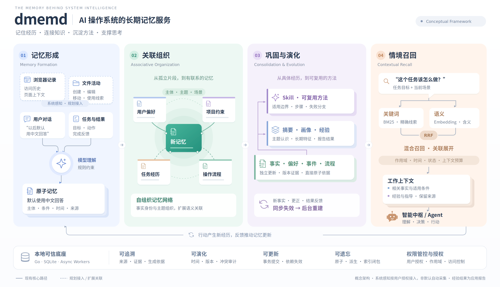

# dmemd：AI 操作系统的长期记忆服务

dmemd 让智能体像人一样记住经历、理解变化、积累经验，为 AI 操作系统的智能中枢、Agent 与应用提供统一的长期记忆底座。
它将对话、任务与结果反馈沉淀为持续演化的记忆，并逐步融合浏览器访问记录、文件操作等系统感知数据，连接分散在不同应用与场景中的用户经历。
通过智能提取、关联组织、分层巩固与情境召回，dmemd 将碎片化信息转化为可复用的知识与技能，让系统智能从单次响应走向持续理解与经验积累。

[快速开始](#快速开始-) · [文档](docs/README.md) · [API 示例](docs/technical-guide.md#http-api-调用示例) · [许可证](LICENSE)

> **使用边界：** 当前面向同一操作系统用户，默认仅监听本机回环地址，不提供认证或应用间权限隔离。
> 数据保存在本地；模型处理会向所配置的模型服务发送相关内容，请按隐私需求选择模型端点。

## Key Features

- **系统级情境感知**：面向浏览记录、文件活动与任务事件等多源信息，构建连接用户行为、工作环境与任务上下文的记忆基础。
- **跨应用记忆协同**：打通应用、会话与 Agent 之间的记忆孤岛，让用户偏好、任务背景与历史经验在整个 AI 环境中连续复用。
- **多层次记忆巩固**：以原子记忆、摘要画像、经验案例与 Skill 构建分层体系，实现从具体经历到综合认识、再到操作方法的知识沉淀。
- **自组织与持续演化**：通过自动分类、关联发现、时序建模与冲突治理，持续整理新旧信息，让记忆随用户与现实变化而更新。
- **情境驱动的智能召回**：融合关键词、语义检索与关联展开，在作用域、时间和上下文预算约束下，为思考与决策提供相关依据。
- **经验驱动的技能进化**：将可复用流程与任务结果反馈结合，积累适用条件、失败经验与操作指导，形成可修正、可迭代的技能资产。
- **用户主导的记忆治理**：以本地持久化、来源追踪、版本管理与依赖失效为基础，让记忆可解释、可纠正、可撤回，并支持贯穿派生知识的永久遗忘。

## 系统框架 🏗️



*从记忆形成、关联组织到巩固演化与情境召回，结合行动反馈构成持续更新的记忆闭环。图中虚线标记规划能力，不代表当前已实现。*

架构与实现细节见[系统架构设计](docs/系统%20AI%20记忆服务架构设计.md)和[技术与使用指南](docs/technical-guide.md)。

## 工作流程 🛠️

1. **提交内容**：应用发送文本、对话或结构化内容，获得异步任务回执。
2. **形成记忆**：后台提取独立信息，与已有事实对照，补充证据或记录变化与冲突。
3. **整理知识**：按主题和作用域生成摘要、画像及符合条件的经验与 Skill，并保留直接来源。
4. **按需召回**：根据查询、作用域与时间等条件，返回相关记忆和派生内容。
5. **反馈与演化**：应用报告执行结果；相关依据变化后，服务使旧内容失效并在后台重新整理。

经验结果是应用报告，不代表独立验证；Skill 是可修正的指导文本，服务不会生成或执行脚本。

## 快速开始 🚀

需要 [`.go-version`](.go-version) 指定的 Go 版本；仅在构建管理台时需要 Node 和 npm。
详细环境要求见[环境说明](docs/technical-guide.md#环境)。

### 1. 获取并构建

```sh
git clone https://github.com/N0rthHXD/dmemd.git
cd dmemd
make build
```

### 2. 配置模型

```sh
config_dir="${XDG_CONFIG_HOME:-$HOME/.config}/dmemd"
mkdir -p "$config_dir"
cp configs/dmemd.example.json "$config_dir/config.json"
chmod 600 "$config_dir/config.json"
```

已有配置时不要直接覆盖。编辑 `config.json`，将 `model.base_url`、`model.name` 及
`model.extraction.name`、`model.decision.name`、`model.governance.name` 的占位值替换为
实际端点和模型名，按需填写 `model.api_key`。也可移除任务级 `name` 字段以继承 `model.name`。
Embedding 默认关闭，首次使用无需配置。

### 3. 启动服务

```sh
./bin/dmemd --check-config
./bin/dmemd
```

默认地址为 `http://127.0.0.1:18432`。模型不可用时仍可启动并接收内容，但新内容的模型处理
需要等待模型恢复；配置检查通过不代表模型连接已验证。

### 4. 接口说明与调用示例

服务通过 HTTP JSON API 接入，默认地址为 `http://127.0.0.1:18432`，无需 Token。
有 JSON 请求体时设置 `Content-Type: application/json`。主要接口如下：

| 方法 | 路径 | 用途 |
| --- | --- | --- |
| `POST` | `/v1/ingestions` | 提交文本、对话或结构化内容，异步提取与整理记忆 |
| `GET` | `/v1/ingest-jobs/{id}` | 查询摄取任务的进度、结果与诊断 |
| `GET` | `/v1/memories` | 列出当前记忆，支持类型、状态等过滤 |
| `POST` | `/v1/memories/recall` | 按查询、作用域、时间与层次统一召回记忆 |
| `GET` | `/v1/memories/{id}` | 查看记忆详情 |
| `GET` | `/v1/memories/{id}/history` | 查看记忆历史版本 |
| `PATCH` | `/v1/memories/{id}/state` | 归档或重新激活记忆 |
| `GET` | `/v1/artifacts` | 查看摘要、画像、经验案例与 Skill 等派生对象 |
| `GET` | `/v1/artifact-targets` | 查看自动整理目标及生成状态 |
| `POST` | `/v1/experiences` | 提交应用报告的任务结果反馈 |
| `GET` | `/v1/skills/{id}/content` | 读取带来源引用的 Skill 指导内容 |
| `GET` | `/v1/memory-conflicts` | 查看待处理或已解决的记忆冲突 |
| `POST` | `/v1/memory-conflicts/{id}/resolve` | 显式裁决记忆冲突 |
| `POST` | `/v1/forget` | 永久遗忘指定记忆、来源或应用报告及相关派生内容 |
| `GET` | `/healthz`、`/readyz` | 检查进程存活与数据库就绪状态 |

**提交内容并查询处理进度**

```sh
curl -sS -X POST http://127.0.0.1:18432/v1/ingestions \
  -H 'Content-Type: application/json' \
  -d '{"content":"以后请默认使用中文回答。"}'
```

提交返回 `202`，响应包含 `source_id`、`job_id` 和 `status`。将下方 `{job_id}` 替换为
实际返回的任务编号；接收成功不代表处理完成，`succeeded` 也不保证所有候选断言都被采纳。

```sh
curl -sS 'http://127.0.0.1:18432/v1/ingest-jobs/{job_id}'
```

**召回相关记忆**

处理完成后，通过关键词查询相关内容。默认返回原子记忆、摘要、经验与 Skill 分区；
可用 `layers` 选择层次。启用并配置 Embedding 后，可增加 `"mode":"hybrid"` 使用混合检索。

```sh
curl -sS -X POST http://127.0.0.1:18432/v1/memories/recall \
  -H 'Content-Type: application/json' \
  -d '{"query":"回答 语言","top_k":5}'
```

**浏览记忆与历史版本**

```sh
# 列出最近更新的 10 条记忆
curl -sS 'http://127.0.0.1:18432/v1/memories?limit=10'

# 将 {memory_id} 替换为列表或召回结果中的实际记忆编号
curl -sS 'http://127.0.0.1:18432/v1/memories/{memory_id}'
curl -sS 'http://127.0.0.1:18432/v1/memories/{memory_id}/history?limit=10'
```

**提交任务结果反馈**

```sh
curl -sS -X POST http://127.0.0.1:18432/v1/experiences \
  -H 'Content-Type: application/json' \
  -d '{
    "run_id":"run-dmemd-check-1",
    "scope_key":"project:dmemd",
    "goal":"修改后验证",
    "conditions":["依赖已安装"],
    "actions":["运行 make check"],
    "outcome":"success"
  }'
```

请仅在实际完成任务后报告相应结果。反馈返回 `202` 和回执；结果视为应用报告，不代表独立验证，
也不保证立即生成经验案例或 Skill。`run_id` 可选，用于结果反馈去重，新的执行应使用新的编号。

更多请求参数、冲突裁决、归档恢复与永久遗忘示例见[完整 API 使用指南](docs/technical-guide.md#http-api-调用示例)，
接口定义见 [OpenAPI 契约](api/openapi.yaml)。

### 5. 使用记忆服务 UI 管理界面（可选）

安装 [`web/package.json`](web/package.json) 指定版本的 Node 和 npm，停止已运行的服务后，
在仓库根目录构建并启动：

```sh
make web-install  # 安装前端依赖
make build-ui     # 构建包含管理界面的 bin/dmemd
./bin/dmemd
```

打开 **<http://127.0.0.1:18432/ui/>**（端口以实际配置为准），即可添加内容、搜索和管理记忆、
查看自动整理结果、处理记录与服务状态。界面随服务内嵌，运行时无需 Node 服务或登录。

注意：`make build` 会覆盖带 UI 的二进制；需要界面时请使用 `make build-ui`。
详见[管理台构建与开发](docs/technical-guide.md#前端管理台)。

## 文档 📚

技术细节集中在 [`docs/`](docs/README.md)：

- [技术与使用指南](docs/technical-guide.md)：功能语义、构建、配置、运行、完整 API 示例与当前限制。
- [系统架构设计](docs/系统%20AI%20记忆服务架构设计.md)：整体设计与架构依据。
- [前端管理台架构](docs/frontend-architecture.md)：页面范围、交互与部署设计。
- [接口与协议](docs/README.md#接口与协议)：HTTP 契约、模型协议与存储契约。
- [测试与验证](docs/testing.md)：开发检查、离线测试、容量场景与真实模型评估入口。

## 许可证 📄

本项目采用 [MIT License](LICENSE)。
