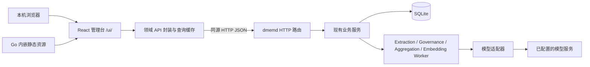

# dmemd 前端管理台架构设计

本文基于当前 HTTP 实现、`api/openapi.yaml` 和 `docs/contracts/api-decisions.md`，定义
前端管理台的模块、部署、页面、状态和接口交互架构。功能范围以现有业务 API 为边界，不新增
或修改后端业务接口。管理台已实现，本文描述 v2 的 Source/L0/当前视图/L1–L4 展示边界，
不将旧时间线、事实组或两阶段 Candidate/Decision 字段重新引入前端。

## 1. 定位与设计原则

管理台是同一操作系统用户的本地记忆工作台，不是多租户后台，也不是新的记忆处理引擎。
核心任务是查看、检索、提交、追溯、裁决和显式遗忘。

- 保持 Go 单进程、SQLite、本地回环监听的部署形态，不增加 Node 运行时服务、BFF 或第二套数据库。
- 前端只调用 HTTP API，不直接访问 SQLite、配置文件、模型供应商或文件系统。
- Source 是原始依据，L0 Observation 是原始观察，Memory 是治理后的当前视图，L1–L4 是
  可失效的派生内容；四者不能混为一张可编辑表。
- 新增和内容更正统一进入摄取流程，不直接编辑 Source/Observation/Memory/派生正文。
- 已采纳不表示真实性已验证；提取成功只表示 L0 形成，治理和聚合有独立任务；经验结果不表示执行已验证。
- 无后端能力时明确收缩页面范围，不用本次返回条数冒充总量，不用浏览器缓存冒充全局任务列表。
- 界面使用中文、桌面优先；保留键盘操作和窄屏阅读能力，不引入 SSR、PWA、实时推送或重型图谱。

## 2. 当前能力与约束

实际路由集中在 `internal/transport/http/handler.go`，由 `internal/runtime/app.go` 装配。
当前根路径仍返回 JSON 404；带 `webui` tag 的构建在 `/ui/` 托管内嵌 SPA，纯 Go 构建不带 UI。

| 能力 | 当前状态 | 对页面的影响 |
| --- | --- | --- |
| 记忆列表、详情、证据、历史 | 已有；列表及历史仅支持 `limit`，没有游标或总量 | 显示“最近 N 条”，不提供完整翻页 |
| 记忆列表过滤 | 类型、生命周期、断言状态、更新时间 | 无事实组/内嵌 topics；不发送无效过滤参数 |
| L0 观察 | 列表、详情、代码 Evidence 和 typed relations | 与当前 Memory 分开，正文只读，可下钻 Source |
| 分层召回 | observations/memories/l1/l2/l3/l4；query_mode、关键词/混合、解释、警告 | 每层独立展示，不提供 as_of/event_at |
| 状态管理与恢复 | 归档、激活、逻辑删除、历史恢复、永久清除 | 管理动作与内容更正分开 |
| 冲突 | 列表、详情、choose/reject_all；版本变化返回 409 | 提交裁决必须带 revision 和全部成员当前版本 |
| 派生对象与生成目标 | 已有列表、详情、指定历史版本；两类列表已有 `next_cursor` | 可真实分页；可发现尚未生成对象的目标 |
| Skill 内容 | 已有当前/指定版本的 `SKILL.md` JSON 响应 | 只预览、复制和显式下载，不执行、不安装 |
| 任务 | `/v1/jobs` 提取列表、`/v1/governance-jobs` 治理/聚合列表与详情 | 区分 category/stage/status，不提供重试或取消接口 |
| 来源 | 仅按 ID 查询、清除原文 | 从证据链接进入详情页，不提供来源列表 |
| 经验报告 | 可提交和撤销，没有报告列表或详情查询 | 案例从 artifacts 发现；报告与派生案例必须区分 |
| 服务诊断 | healthz、readyz、Embedding 状态与显式探测 | 无模型配置编辑、治理开关或全局统计接口 |
| 认证与隔离 | 无；配置只允许回环监听 | 不设计登录页、角色权限或基于 app_id 的授权 |

普通列表没有总量或下一页，artifacts/targets 单独支持游标；分页边界见
[API 契约](contracts/api-decisions.md)。记忆列表非法更新时间返回 400，不能统一假设所有
列表或召回参数采用相同的容错规则。

## 3. 总体架构与部署



### 3.1 生产运行

- 访问 `http://127.0.0.1:18432/ui/`；端口以实际配置为准，不在前端硬编码。
- 前端产物通过 Go `embed.FS` 内嵌，随带 UI 的二进制发布；运行时不需要 Node。
- `/v1/*`、`/healthz`、`/readyz` 保持现有路径和 JSON 语义；不把 `/` 改成 SPA 兜底。
- `/ui` 重定向至 `/ui/`，仅 `/ui/` 内的页面路由允许回退到 `index.html`。
- `/ui/assets/*` 缺失必须返回 404，未知 API 仍返回 JSON 404，不能回退为 HTML。
- `index.html` 不长缓存，带内容 hash 的静态资源可长期缓存；API 与敏感内容不做持久 HTTP 缓存。
- UI 外壳不依赖数据库 readiness，数据库故障时仍能打开诊断页面。

`internal/webui` 只负责内嵌、静态响应和 SPA 路径处理，不能依赖业务服务。
由 runtime 将其作为可选 handler 注入 HTTP 层；不把前端产物混入 memory 等领域包。

### 3.2 开发与构建

开发时 Vite 代理 `/v1`、`/healthz`、`/readyz` 到本地 dmemd；浏览器仍发同源请求。
开发服务绑定回环地址，代理目标由开发配置指定，不修改后端现有跨域行为。

Go-only 构建与带 UI 构建分离：

| 命令 | 职责 |
| --- | --- |
| `make web-dev` | 启动前端开发服务，后端单独运行 |
| `make web-check` | 生成类型校验、类型检查和 lint |
| `make web-build` | 构建到 `internal/webui/dist/` |
| `make build-ui` | 先构建前端，再以 `webui` build tag 构建内嵌 UI 的二进制 |
| `make build` / `make check` | 保留现有纯 Go 命令，不隐式要求 Node |

使用带 `webui` tag 的 embed 实现及不带 tag 的空实现，使纯 Go 构建不依赖 dist 目录；
带 UI 构建缺少产物时直接失败。前端依赖由锁文件固定，`dist/` 和 `node_modules/` 不入库。

## 4. 技术选型

前端采用以下技术栈，具体依赖版本由 `package.json` 和 `package-lock.json` 固定。

| 层 | 选择 | 原因 |
| --- | --- | --- |
| 应用 | React + TypeScript 严格模式 + Vite | 纯 SPA，工具链简单，适合后端内嵌发布 |
| 路由 | React Router | `/ui/` basename、嵌套路由、可直达详情 |
| 组件 | Ant Design，中文 locale | 表格、表单、抽屉、确认对话框和通知成熟 |
| 样式 | 设计 token + CSS Modules | 统一密度和主题，不再叠加第二套 UI/Tailwind 体系 |
| 服务端状态 | TanStack Query | 缓存、请求去重、失效、分页和轮询 |
| HTTP 与类型 | 原生 fetch + openapi-fetch / openapi-typescript | 契约驱动、AbortSignal；业务端点集中封装 |
| 表单 | Ant Design Form | 不引入第二套表单和全局状态库 |
| 内容预览 | 安全 Markdown 渲染器 + 只读 JSON 视图 | 禁用 HTML、远程图片和可执行内容 |
| 依赖管理 | npm + package-lock.json | 单包工程，使用 `npm ci`，不引入 monorepo 工具 |

不选 Next.js/SSR：本地管理台没有 SEO、服务端页面渲染或独立 Node 服务需求。
不选微前端：只有一个工作台，拆分部署会增加版本兼容和本地运维成本。

## 5. 页面与导航

采用左侧导航、顶部服务状态、主体工作区。列表到详情可用路由驱动的侧面板，刷新或直接
访问详情 URL 时仍可完整展示；宽表格在窄屏降为卡片，冲突对比降为纵向排列。

| 导航 | 前端路由（均位于 `/ui`） | 主要内容 |
| --- | --- | --- |
| 概览 | `/overview` | 存活/就绪、Embedding 覆盖、最近记忆和待关注状态，不展示全局统计 |
| 记忆库 | `/memories`、`/memories/:id`、`/observations/:id` | L0 观察与当前 Memory 分开浏览、证据、历史和 typed relations |
| 检索工作台 | `/recall` | 查询、scope、query_mode、六层结果、关键词/混合、解释和 stale 回退 |
| 内容提交 | `/ingestions/new` | 文本与 JSON 模式、显式 scope、接收回执和任务跟踪 |
| 处理任务 | `/jobs`、`/jobs/:id` | 最近提取/治理/聚合任务，独立状态与诊断；不提供重试、取消操作 |
| 冲突中心 | `/conflicts`、`/conflicts/:id` | open/resolved、成员对比、证据、裁决与审计 |
| 派生知识 | `/artifacts`、`/artifacts/:id` | 主题摘要、作用域概览、画像、经验案例与 Skill |
| 生成目标 | `/artifact-targets` | 排队、运行、等待、无合格输入、失败、stale 等原因 |
| 服务诊断 | `/system` | health/readiness、Embedding 配置摘要、覆盖、积压、显式探测 |

辅助详情 `/sources/:id` 从证据进入。经验报告提交及已知 ID 的撤销可作为派生知识页的辅助
交互；现有接口不支持报告查询，因此不提供完整报告详情，也不把 `experience_case` 当作报告记录。
历史通过 `?version=N` 定位；派生对象暂无历史列表 API，按当前版本选择并惰性读取指定版本。
任务页使用服务端最近列表而非仅浏览器本会话集合；列表是有界结果，不称为全量历史。
提取 succeeded/observations_saved 不表示 Memory 或派生生成完成，应继续查看独立治理/聚合任务。

### 5.1 范围与筛选

- scope 是平面标签，不渲染为权限树；缺失表示未知，不自动补成 `user`。
- 召回指定 scope 时会包含该 scope 和用户全局范围，需在表单旁明确说明；不把它叫“严格隔离”。
- 记忆列表当前没有 scope/topic 过滤，不将其他页面的范围选择静默应用到本页。
- 范围为手动输入及本会话建议项；不提供全局 scope/topic/app 枚举。
- 列表筛选、游标和版本可放 URL；正文、原始输入、自然语言查询和来源片段默认不放 URL。
- 检索是显式提交，不逐字发送请求，不提供实时联想。

### 5.2 信息层次

主列表显示标题/摘要、类型、生命周期、断言状态、scope、更新时间；详细诊断按需展开。
状态必须带文字，不能只依赖颜色：

- 生命周期：活跃 / 已归档 / 已删除。
- 断言状态：已采纳 / 待裁决 / 已否定。
- 观察状态：observed / pending / retracted / deleted，与 Memory 的采纳状态分开。
- 时间：只展示服务记录时间，以及 Source span 原始 occurred_at 元数据；不渲染不存在的事实时间。
- 派生状态：可用 / 已失效 / 已停用；生成状态另外展示，不压缩成一个“正常/异常”图标。

精确记录时间可按用户时区展示并提供 UTC 原值；原文时间表达保留为自然文本，不将接收时间
当作事件发生时间。后续 annotation 能力未实现前不设计时间线、precision/basis 或 retention 控件。

## 6. 前端代码组织与状态

```text
web/
  package.json
  package-lock.json
  vite.config.ts
  src/
    app/                  # 入口、路由、布局、Provider、主题、错误边界
    features/
      overview/
      memories/           # 页面、领域组件、query keys、API 调用及展示映射
      observations/       # L0 列表面板、详情、证据与关系
      recall/
      ingestions/
      jobs/
      conflicts/
      artifacts/          # 摘要/画像/经验/Skill 与生成目标共用领域模型
      sources/
      system/
    shared/
      api/                # generated schema、HTTP client、ApiError
      ui/                 # 空态、状态标签、危险操作确认、代码/Markdown 视图
      lib/                # 时间格式化、路由构造、固定原因码文案
internal/webui/            # Go 静态资源托管与 build-tag 实现
  dist/                   # 生成产物，不入库
docs/frontend-architecture.md
```

依赖方向为 `app → features → shared`；feature 不跨域导入另一 feature 的内部状态。
复用稳定的 API 类型和共享展示组件，不提前为每个字段建立复杂领域对象层。

| 状态 | 放置位置 | 约束 |
| --- | --- | --- |
| 记忆、历史、任务、派生对象 | TanStack Query | 不复制到 Redux/Context，不持久化到磁盘 |
| 路由、可公开的筛选、选中版本 | Router/URL | 直接进入详情和浏览器后退可恢复上下文 |
| 表单、待提交裁决、面板开关 | 页面本地 state/Form | 离开时提示未提交内容，默认不自动保存草稿 |
| 主题、表格密度 | 小型 preferences context/localStorage | 只存非敏感偏好，不存正文、查询或资源 ID 历史 |

Query key 统一按领域、ID、版本或规范化过滤参数构造；集合参数排序，切换筛选重置游标。
缓存只在内存短期存在，生产不启用持久化 Query 缓存、Service Worker 或离线重放队列。

## 7. API 接入、刷新与错误处理

### 7.1 契约驱动

- `api/openapi.yaml` 是前端类型生成输入；运行行为以现有 HTTP 实现为准，不用 `any` 掩盖类型差异。
- JSON 边界保留 `snake_case`，仅在需要时映射到页面展示模型；生成文件不手工修改。
- 统一 HTTP client 使用同源地址、`cache: no-store`、超时和 AbortSignal，不发送伪 Token。
- 类型生成只提供静态检查；异常 Content-Type、JSON 解码失败或关键响应形状错误须显示协议错误，
  不把服务异常当成空数据。
- 错误抽象包含 `status`、可选 `code` 和用户可读摘要；未知警告/原因码保留原码并使用兜底文案。
- artifacts 列表返回的是元数据，不假设存在正文；详情按需查询，避免一次为整页并发拉取所有正文。

### 7.2 刷新和轮询

- 普通列表手动刷新及窗口重新聚焦刷新，不轮询全部历史和证据。
- 只有当前可见、非终态的任务轮询：queued/running 建议 2 秒，waiting 建议 5～30 秒；
  页面隐藏时暂停，失败后退避，恢复可见时重新读取，不承诺模型完成百分比。
- succeeded/failed/cancelled 停止自动轮询；waiting 不是终态，显示原因和下次尝试时间。
- 生成目标只在当前页面存在活动目标时低频刷新；Embedding 状态可在诊断页 15～30 秒刷新。
- 提交或裁决成功后失效相应列表、详情、历史、冲突、派生对象/目标和旧召回结果；后台任务完成
  后再刷新一次相关结果。删除/清除需要取消相关在途查询，防止迟到响应重新显示旧内容。
- 归档、裁决、恢复和永久操作默认使用服务端确认结果，不进行乐观“删除成功”。

### 7.3 错误语义

| 情况 | 页面行为 |
| --- | --- |
| 网络不可达 | 显示本地服务连接失败，保留页面上下文，提供手动重连；不等同于空库 |
| 400 | 保留表单并提示请求无效；已知错误码给出对应帮助 |
| 404 | 显示不存在/可能已永久清除，不能伪造快照 |
| 409 | 阻止盲目重试，重新读取冲突或恢复目标，要求重新确认 |
| 500/503 | 明确内部错误/服务未就绪；可对只读请求有限退避 |
| 200 带 warnings | 保留有效结果，同时展示降级、不确定性或截断原因 |
| 202 | 显示已接收并跟踪后续状态，不立即提示“记忆已创建” |

写请求默认不自动重试。特别是摄取没有幂等协议，超时可能发生在提交之后，应提示“结果未知”，
不能自动重发；无查询恢复能力时让用户主动决定是否再次提交。

## 8. 关键业务交互

### 8.1 查看与更正记忆

列表 → 当前快照 → Observation refs / 历史 / Evidence / Source / typed relations。正文只读。“提交更正”打开摄取表单，供用户
补充明确事实、上下文和 scope，再通过 `/v1/ingestions` 提交。

当前接口不支持精确指定更正目标，不承诺提交后一定修改当前 ID；携带 ID 的说明也只是内容，
不是强制定位协议。提取先返回 Observation IDs，后续治理才可能补证、新增或保留 pending，
应按各阶段实际结果展示，不在 Extraction 完成时宣称某个 Memory ID 已修改。

### 8.2 冲突裁决

1. 读取冲突详情及全部成员当前快照；检测版本与当前版本分开展示。
2. 展示不同陈述、scope、Observation、证据和当前断言状态，成员请求有界并发。
3. 只提供当前支持的 `choose`、`reject_all`，不提供 timeline/separate_scope。
4. 提交携带冲突 `revision` 及全部成员已读取的当前 `member_versions`。
5. 任一版本变化返回 409 后，原草稿仅可作为参考，重新加载并确认，不能自动替换版本重发。

前端不自行将 pending 提升为 accepted，不把关系模型的 supersedes 当作裁决完成。

### 8.3 分层召回

- L0、当前 Memory、L1、L2、L3、L4 六分区呈现，各层分数不混排或相加。
- keyword/hybrid 只改变当前 Memory；L0/派生层仍是关键词检索。
- `top_k` 是每个所选层的上限，不显示为全部结果总上限。
- query_mode 选择概览/细节/关系历史/冲突/指导，显式 layers 优先；history 不是 as_of。
- stale 默认不显示为当前结论；显式 stale 结果与 derived_stale_fallback 必须保留文字说明。
- dependencies 提供下钻引用，不假设不同层内容已语义去重，也不把展示聚合当作数据合并。
- `explain` 按需开启，BM25/余弦/RRF 不展示为“真实性置信度”。语义降级保留关键词结果及警告。

### 8.4 派生知识审计

正文旁显示 layer、当前状态、失效原因、生成版本和 typed dependencies。memory/derived 引用
进入准确版本，observation 引用进入 L0，experience 引用仅显示 ID；不伪造报告详情 API。
payload 按已知字段展示，未知结构作为只读 JSON；区分输入预算、truncated 和依赖存在，不能
将引用合法解释为语义完整，也不沿用旧模型 citations/provenance 作为来源事实。

stale/disabled 仍可审计，但明确不参与默认召回。暂无手动重新生成、启停、编辑派生正文的接口，
不提供这些按钮。Skill 下载必须由用户点击触发，所有经验/Skill 页面保留“应用报告/指导文本”说明。

### 8.5 删除、清除与永久遗忘

| 操作 | 真实含义 | 交互要求 |
| --- | --- | --- |
| 归档 | 保留数据，退出默认召回 | 普通确认，显示对派生内容的影响 |
| 逻辑删除 | 保留墓碑、历史与证据 | 明确可通过历史恢复，不称为永久遗忘 |
| 历史恢复 | 复制为新的 active 版本，不覆盖历史或提升断言 | 展示版本差异，不宣称自动裁决冲突 |
| 清除来源原文 | 清除原文/证据并撤回关联 L0、传播失效；无其他支持的 Memory 逻辑删除 | 显示实际 retracted_observations/invalidated_derived_ids，不与永久遗忘合并 |
| 单条 purge | 永久清除该记忆及专属数据，共享来源保留 | 高风险确认；不是按来源或重复事实闭包遗忘 |
| 永久遗忘 | 按显式 ID、来源/历史引用与依赖传播，不猜测事实组副本 | 区分物理清理与间接 stale/disabled；不承诺擦除所有外部/历史副本 |

永久操作需再次确认目标类型与 ID，并输入确认文字；默认不开放批量永久清除。
当前无服务端 dry-run，前端只能展示所选目标与已知规则，不能给出精确影响预览或承诺仅删除
页面可见项。完成后以服务端返回的 memory_ids/source_ids/experience_ids 为准；没有旧版
retained_related_memory_ids。仅被递归失效的间接派生历史仍可审计，不能宣称正文已物理擦除。
