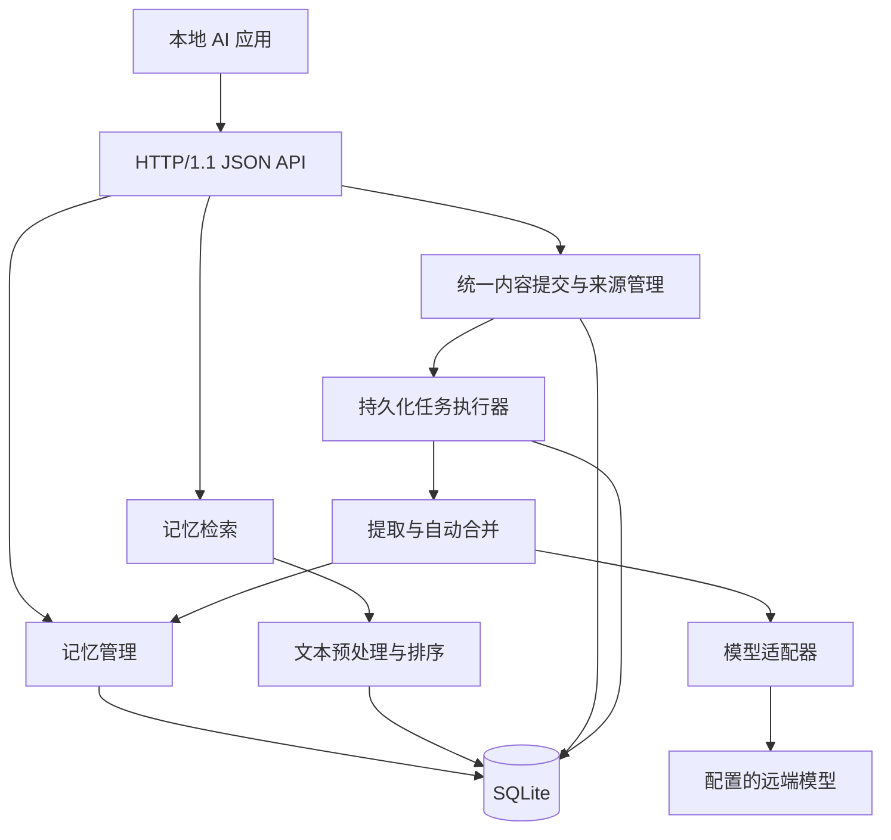

# 系统 AI 记忆服务架构设计（v1）

## 一、总体架构与模块划分

### 服务定位与设计边界

`dmemd` 是使用 Go 实现的轻量级用户系统 AI 记忆服务，为同一操作系统用户的多个 AI 应用提供统一的长期记忆能力。应用只负责提交内容，由服务统一完成整理、提取、合并和持久化。

采用以下已确认的设计前提：

- 每个操作系统用户运行一个服务实例，本地应用共享全部记忆，允许跨应用读取和修改，不设置应用准入或认证流程。
- 所有对话、事件、自然语言描述和已有结构化内容使用同一个提交接口，不区分直接写入和模型自动写入。
- 自动提取优先使用配置的远端模型，允许自动新增和更新记忆。
- 首版支持关键词检索、混合检索、结构化过滤和可解释排序；统一召回按原子、摘要、经验和
  Skill 分层组装。
- 首版容量实测规模为一万条原子记忆及对应派生量；十万条以内是后续容量阶段目标，仍需单独
  实测，不能由首版验收推断。
- 原始输入默认保留在本地，支持显式清除。

采用**单进程、模块化架构**：HTTP 服务、后台任务和生命周期管理运行在同一进程，业务数据与任务队列统一保存在 SQLite 中。

接口不设置业务写入校验、条件请求、请求幂等协议或分页协议。仅保留正常处理所需的 JSON 解码、存储事务和执行错误反馈。



### 模块职责

| 模块             | 职责                                                         |
| ---------------- | ------------------------------------------------------------ |
| `transport/http` | 路由、JSON 编解码、调用业务模块和错误响应；不做身份认证、安全校验或业务字段校验 |
| `memory`         | 创建、更新、删除、恢复、版本管理、生命周期规则与统一写入事务 |
| `source`         | 原始对话和事件管理、证据定位、原文清除                       |
| `ingest`         | 统一内容接收、任务编排、候选生成、内容合并和自动更新         |
| `governance`     | 持久治理任务、单 Worker、分类、冲突复查、聚合、经验案例、Skill 生成和周期对账 |
| `artifact`       | 摘要/画像/经验案例/Skill 的版本、直接原子依赖、失效和派生 FTS |
| `skill`          | 指导型工作流输入输出、自动启用和 `SKILL.md` 渲染             |
| `retrieval`      | 查询规范化、关键词/混合检索、统一分层召回和结果组装          |
| `model`          | 模型调用接口、远端协议适配和结果解析                         |
| `store/sqlite`   | SQL、事务、迁移、全文索引、持久化任务与派生对象              |
| `runtime`        | 配置、启动关闭、任务调度、日志、健康检查和降级状态           |

依赖方向为 HTTP → 业务模块 → 存储或模型接口。SQL 集中在存储模块；模型结果由服务内部解析和整理后保存，不增加独立的业务校验层。

关键内部接口按能力划分为 `IngestService`、`MemoryService`、`RecallService`、`Writer`、
`ExtractionProvider`、`Governance.Handler` 和 `Store.WithTx`。不为每张表单独创建一套业务服务。

## 二、记忆存储、版本证据与生命周期

### 记忆数据模型

一条记忆表达一个可以独立更新、检索和追溯的事实、偏好、事件或操作经验。以下为服务处理后的存储模型，不要求调用方在提交内容时提供这些字段。

| 字段                       | 含义                                                         |
| -------------------------- | ------------------------------------------------------------ |
| `id`                       | 服务生成的 UUID，生命周期内不变                              |
| `kind`                     | `fact`、`preference`、`event`、`procedure`                   |
| `title`                    | 简短标题                                                     |
| `content`                  | 面向应用使用的自然语言记忆正文                               |
| `state`                    | `active`、`archived`、`deleted`                              |
| `version`                  | 从 1 开始、逐次递增的整数                                    |
| `observed_at`              | 事实或来源事件发生时间，用于处理新旧信息                     |
| `created_at`、`updated_at` | 服务端记录时间                                               |

记忆以 `id` 标识。服务根据内容、关键词和相关记忆判断重复或更新关系，不要求调用方构造全局唯一的逻辑标识。记忆不设置自动到期机制。

### 持久化方案

采用 `database/sql` 与 `modernc.org/sqlite`，减少部署时对 CGO 工具链的依赖；该驱动提供不依赖 CGO 的 SQLite 实现。依赖版本在实现时固定，并通过集成测试验证 FTS5 能力。([pkg.go.dev](https://pkg.go.dev/modernc.org/sqlite))

主要表如下：

| 表                                 | 内容与约束                                                   |
| ---------------------------------- | ------------------------------------------------------------ |
| `memories`                         | 当前快照，以 `id` 为主键；含作用域、主题、断言和有效时间     |
| `memory_revisions`                 | 每次变更的完整快照、操作类型和原因；唯一键为 `(memory_id, version)` |
| `sources`                          | 每次提交的原始内容、可选应用标识、可选外部标识、作用域和接收时间 |
| `evidence`                         | 来源引用、可选消息标识、原文片段和定位信息                   |
| `revision_evidence`                | 某一记忆版本与证据之间的关联                                 |
| `memory_search_docs`、`memory_fts` | 可重建的规范化搜索文档与 FTS5 索引                           |
| `ingest_jobs`                      | 内容处理任务、状态、重试次数、错误和结果摘要                 |
| `memory_fact_groups`、`memory_conflicts` | 事实组、成员版本和未决冲突审计                         |
| `governance_jobs`                  | 固定治理目标、revision、状态、退避和输入哈希                 |
| `artifacts`、`artifact_revisions`  | 派生对象当前状态、不可变版本、直接原子/运行依赖              |
| `artifact_search_docs`、`artifact_fts` | 当前 active 派生版本的规范化 FTS5 索引                   |
| `experience_runs`                  | 应用报告的结果、可选 Skill 版本、撤销状态                    |
| `schema_migrations`                | 数据库结构版本                                               |

持久化约定：

- 数据默认放在用户数据目录下，目录权限 `0700`，数据库和凭据文件权限 `0600`。
- 启用 WAL、外键、`synchronous=FULL` 和有界等待；所有连接统一初始化。
- 使用单写连接和小型读连接池。SQLite WAL 支持读写并行，但同时只有一个写事务，因此模型调用和长时间计算必须放在事务之外。([sqlite.org](https://www.sqlite.org/wal.html))
- 当前快照、版本、证据关联和全文索引在同一个事务内提交。
- 索引是派生数据，业务表是事实来源；迁移或索引规则变化后可重建。
- 当前不提供自动备份/恢复。发布首版如需备份，必须使用 SQLite 一致性备份、停止写入并验证
  结构与索引；手工复制主文件不构成一致备份。([sqlite.org](https://sqlite.org/backup.html))

### 版本与证据

每次内容、状态或证据集合变更都生成新版本。版本仅用于追溯和恢复，不作为接口调用的前置条件。恢复旧版本时，复制其内容生成一个新版本。

所有提交内容都保存来源记录，生成的记忆通过 `source_id` 关联原始输入，可以附带消息标识、原文片段和模型名称。引用片段能够定位时记录位置，无法定位时保留来源关联即可，不因此拒绝整批内容。调用方不需要构造或提交证据。

新版本保存其完整证据集合。更正事实时，不把支持旧结论的证据直接继承为新结论的支持证据；旧证据仍可通过历史版本查询。

### 生命周期

| 状态       | 含义                     | 默认检索             |
| ---------- | ------------------------ | -------------------- |
| `active`   | 当前有效                 | 返回                 |
| `archived` | 主动归档                 | 不返回               |
| `deleted`  | 逻辑删除，保留墓碑和历史 | 不返回               |

具体规则：

- 创建后默认 `active`，由应用主动归档或删除，不运行到期维护任务。
- 归档、删除和恢复均生成版本；恢复后可以重新进入默认检索。
- 后台整理默认只合并 `active` 记忆，不自动恢复已归档或删除的记录。
- 普通删除保留历史；显式永久清除时，删除当前记录、历史、专属证据和索引，共享来源不随之删除。
- 清除来源原文时，同时清除其证据引用中的原文副本，保留来源标识和 `redacted` 状态；已形成的记忆正文继续保留。版本不可变规则对这种显式清除操作作例外处理。
- 原子记忆或运行结果变化时，同一短事务使直接依赖的摘要、画像、经验案例和 Skill 退出默认
  召回并登记重算；删除和永久清除立即生效，不等去抖。派生对象不反向成为原子事实。

### 派生层与治理

原子记忆仍是事实来源。首版在原子层之上保存三类派生内容：

| 层 | 内容 | 生成方式 |
| --- | --- | --- |
| L2 | `topic_summary`、`profile`、`experience_case` | 治理 Worker 从有限原子记忆和结构化运行摘要生成 |
| L3 | `skill` | 从 procedure 和经验结果生成指导型 `SKILL.md` |
| 工作视图 | 一次召回选中的原子、摘要、经验和 Skill | 临时组装，不重新入库 |

派生版本保存直接原子修订和应用结果引用，不建立 artifact→artifact 持久依赖。原子或运行结果
变化时，同一短事务把受影响对象置为 `stale`、删除当前派生 FTS 文档并登记重算；删除或永久
清除立即移除对象。只有 `active` 当前版本进入默认召回，历史版本仅用于追溯。模型调用在事务
外，提交前比较治理任务 `revision`，旧结果不能覆盖新输入或恢复已删除内容。

治理任务固定为 `classify/review_conflict/aggregate/build_skill/reconcile`，按
`(kind,target_key)` 唯一并直接由业务事务登记。单 Worker 顺序执行，普通目标去抖，删除和撤销
立即处理；网络/限流错误延期重试，连续协议错误隔离。模型文本不能修改配置、授予工具权限或
触发执行。应用结果反馈保存为报告，Skill 只是可修正的指导内容，不提供执行认证。

## 三、统一内容提交与处理流程

### 统一提交入口

所有待记忆内容使用 `POST /v1/ingestions` 提交，包括对话、事件、自然语言描述和已有结构化内容。不提供独立的直接写入、来源创建或模型提取提交接口，也不要求调用方指定提取模式。

1. 接收并解码 JSON，不执行身份、字段取值、证据、版本或重复提交校验。
2. 在同一事务中保存原始输入和后台处理任务。
3. 返回 `202`，在 JSON 响应体中给出 `source_id` 和 `job_id`。
4. 后台读取任务，统一整理输入并生成记忆候选。
5. 根据关键词和内容查找相关记忆，由服务决定新增、更新、合并证据或跳过。
6. 在短事务中保存记忆变更、版本、来源关联和索引，并更新任务结果。

调用方只负责提交内容，不需要先查询当前版本、生成去重标识或准备证据。结构化内容与原始对话进入同一条处理链路，提交成功表示内容已经接收；处理完成后，生成的记忆可以检索。

重复请求按普通提交处理，不承诺请求级幂等；内容层面的重复由后台整理时尽量合并。

### 后台处理

```text
保存原始输入与任务
    → Worker 读取任务
    → 模型整理输入并生成记忆候选
    → 按关键词与内容查找相关记忆
    → 判断新增、更新、补充证据或跳过
    → 保存记忆变更并更新任务结果
```

执行细节：

- HTTP 不等待模型完成；即使内容已经是结构化记忆，也由服务统一处理。
- 远端调用通过 `ExtractionProvider` 隔离，配置包含模型标识、地址、模型服务凭据和超时。这些凭据用于调用远端模型，与本地 API 的可选 Token 无关。
- 模型只接收当前输入和相关记忆上下文。
- 同一事实有明确更新关系时更新原记录；不同时间的独立事件分别保存；无法确认关联时单独新增。
- 新旧信息可以结合 `observed_at` 和服务接收时间判断；重复内容尽量合并来源证据。
- 模型结果由服务解析和整理，能够使用的结果正常处理，缺失的辅助字段使用默认值；整体无法解析时记录任务失败原因。
- 默认单个 ingest Worker 和一个独立治理 Worker 串行处理任务，使用 SQLite 写事务依次提交
  结果；不引入租约或分布式调度。治理任务以 `(kind,target_key)` 唯一，输入变化递增 revision，
  迟到结果不能覆盖新状态。
- 清除来源时取消相关未完成任务；保存结果的事务中读取任务取消状态，已取消则不提交模型结果。

任务状态为 `queued/running/waiting/succeeded/failed/cancelled`。网络、限流、超时和 Provider
暂不可用进入 `waiting`，按 5 秒、30 秒、2 分钟递增后退避，之后最长每 30 分钟重试；连续三次
解析/协议错误进入 `failed` 等待输入或协议变化。首版重启后把遗留 `running` 重新排队，不引入
租约或分布式调度。记忆变更和任务成功状态在同一事务提交，已成功的任务不再次执行。治理 Worker
异常按指数退避重启，耗尽预算只降级后台整理，不关闭 HTTP 或原子查询。

模型不可用时，内容仍可提交并保存，任务按上述策略重试；已有记忆的查询、检索和管理继续工作。

## 四、统一分层召回

### 召回接口与查询语义

提供唯一召回入口 `POST /v1/memories/recall`：

```json
{
  "query": "修改 dmemd 后应该如何验证",
  "scope_key": "project:dmemd",
  "layers": ["atomic", "summary", "experience", "skill"],
  "max_context_tokens": 3000,
  "filters": {"kinds": ["procedure"], "states": ["active"]},
  "top_k": 20,
  "explain": true
}
```

约定：

- `query` 为普通关键词文本，不直接暴露 FTS 查询语法；缺失或空白返回空分区。
- `layers` 可选 `atomic/summary/experience/skill`；省略时选择全部层，显式列表只检索对应层，
  未选择或未命中的分区返回空数组。
- `filters.kinds/states` 只过滤原子层，不隐式排除摘要、经验或 Skill；默认只返回 accepted 的
  active 记忆，归档需显式请求，删除墓碑永不进入检索。
- `mode` 只影响原子层，支持 `keyword` 和 `hybrid`；派生层固定使用派生 FTS，不新增向量队列。
- `filters.as_of` 只支持原子层历史时点；含派生层的请求返回空派生分区并附
  `derived_as_of_unsupported`。
- `top_k` 默认 20，最大 100；各层分别执行上限。
- `max_context_tokens` 使用保守 rune 估算，超预算截断并返回 `context_budget_truncated`。
- 召回只读取已有内容，不等待后台聚合或 Skill 生成，也不因治理故障阻断原子结果。

响应按知识层分区：

```json
{
  "memories": [],
  "summaries": [],
  "experiences": [],
  "skills": [],
  "conflicts": [],
  "warnings": []
}
```

摘要、经验案例和 Skill 保留自身 ID、版本、状态、直接原子依据和运行依据，不写成原子记忆，
也不与原子分数直接相加。经验结果是应用报告，Skill 只是可修正的指导文本；响应不提供真实性、
执行成功或安全认证。

### 关键词检索与中文处理

采用 SQLite FTS5，索引当前版本的标题和正文。

FTS5 的默认 `unicode61` 将连续字母和数字类字符视为 token，不能直接承担本设计所需的中文词内匹配。因此在 Go 层对文档和查询使用同一套预处理。([sqlite.org](https://www.sqlite.org/fts5.html))

采用确定性的处理规则：

- 统一 Unicode 规范形式和英文大小写。
- 英文、数字按词处理；汉字使用内置词典精准分词，索引与查询共用同一分词规则。
- 每个分词词项独立参与匹配；`all` 对原始词项做 `AND`；keyword 模式的 `any` 先按受控停用词表选择有效词项，再以 `OR` 召回候选并按覆盖率重排，不设置最低命中数，不再把连续汉字或整句查询编译为一个相邻短语。
- 受控停用词只覆盖疑问词、辅助词和通用词；保留实体、数字、时间表达和否定词。全部被移除时回退原分词，不生成无约束查询。
- 空白和标点作为边界；不做 n-gram 扩展。
- 用户文本经过转义和参数绑定，不能注入 FTS 运算符。
- 关键词路不做同义词扩展；`hybrid` 只增加独立 Embedding 余弦候选，经 RRF 融合，语义超时或
  不可用时回退关键词并返回固定 warning。

搜索文档及 FTS 索引在记忆保存事务中同步更新，索引保存全部未删除记忆，查询时按状态过滤。采用外部内容表时，通过触发器保持同步，并覆盖初始化重建流程。([sqlite.org](https://sqlite.org/fts5.html))

### 排序与返回结构

关键词模式先按加权 BM25 召回，标题、正文权重分别为 `4、1`。`any` 查询随后按 BM25 名次与有效词项覆盖率做有界融合，`all` 保持 BM25 顺序。最终顺序为：

1. 上述相关性分数降序。
2. 同分保持原 BM25 候选顺序；该顺序已按 `updated_at` 降序、`id` 升序消歧。

FTS5 的 BM25 数值越小越相关。显式 `all` 对外返回 `score = -bm25`；经过覆盖率重排的
`any` 返回有界融合分数。数值越大越相关，分数只用于当前查询内比较，不表示事实可信度。
([sqlite.org](https://www.sqlite.org/fts5.html))

```json
{
  "memories": [
    {
      "memory": {
        "id": "uuid",
        "kind": "preference",
        "title": "回答语言",
        "content": "用户希望默认使用中文回答。",
        "state": "active",
        "version": 3,
        "scope_key": "project:dmemd",
        "topics": ["language"]
      },
      "score": 0.0000042,
      "snippet": "用户希望默认使用中文回答。",
      "matched_terms": ["回答", "语言"],
      "evidence_refs": [
        {"id": "evidence-uuid", "source_id": "source-uuid"}
      ],
      "explanation": {
        "ranking": "bm25",
        "field_weights": [4, 1]
      },
      "temporal_status": "unknown",
      "conflict_refs": []
    }
  ],
  "summaries": [],
  "experiences": [],
  "skills": [],
  "conflicts": [],
  "warnings": []
}
```

摘要从原始记忆正文生成，不直接返回索引词项拼接文本；不嵌入 HTML。`explanation` 仅在请求
指定时返回。派生条目包含 `kind/title/content/state/truncated/memory_refs/run_refs` 等自身
字段，不伪装为原子记忆。

## 五、HTTP API、运行约定与验收

### 传输与通用约定

- 使用 Go `net/http`，提供本地 HTTP/1.1、UTF-8 JSON API，路径统一为 `/v1`。([pkg.go.dev](https://pkg.go.dev/net/http))
- 默认监听 `127.0.0.1:18432`，端口可配置。
- 带 JSON 请求体时，只需设置 `Content-Type: application/json`；不要求其他应用自定义请求头，无请求体的请求也不要求该头。
- `Authorization: Bearer <token>` 为可选头。不携带也可以调用全部本地接口；首版不验证 Token，不根据其设置访问权限或确定应用身份。
- 应用可在提交内容时通过 `app_id` 附带来源名称，省略也可正常处理。该字段仅用于来源记录。
- 不要求签名、幂等键或版本匹配请求头，不进行业务字段、来源证据或内容长度校验，也不额外设计请求大小限制。
- 响应仅使用普通 HTTP 状态码和 JSON；有响应体时设置 `Content-Type: application/json`，标识和处理结果放在响应体中，不返回额外的位置或版本控制头。
- 所有时间使用 UTC RFC 3339；ID 使用字符串；JSON 字段使用 `snake_case`。
- 列表不分页，不设置游标、页码或偏移量。可通过过滤条件和可选 `limit` 控制本次返回数量，不返回下一页信息；记忆列表默认返回最近更新的 50 条。
- `PATCH` 用于修改已有记忆的状态。新增或更正记忆内容仍通过统一提交接口处理。

### API 清单

| 方法与路径 | 功能 | 成功响应 |
| --- | --- | --- |
| `POST /v1/ingestions` | 统一提交待记忆内容，保存来源并排队处理 | `202`，`source_id`、`job_id`、任务状态 |
| `GET /v1/memories` | 按类型、状态、来源应用等过滤，返回本次列表 | `200`，`items` |
| `GET /v1/memories/{id}` | 获取当前快照 | `200`，记忆 |
| `PATCH /v1/memories/{id}/state` | 更新记忆状态 | `200`，更新后的记忆 |
| `DELETE /v1/memories/{id}` | 逻辑删除 | `200`，记忆 ID 和状态 |
| `POST /v1/memories/{id}/purge` | 永久清除记忆及其历史 | `200`，记忆 ID 和清除结果 |
| `GET /v1/memories/{id}/history` | 返回版本历史，可用 `limit` 限制数量 | `200`，`items` |
| `GET /v1/memories/{id}/history/{version}` | 获取指定版本 | `200`，版本内容 |
| `POST /v1/memories/{id}/history/{version}/restore` | 从指定历史版本恢复记忆 | `200`，恢复后的记忆 |
| `GET /v1/memories/{id}/evidence` | 查询当前或指定版本的来源证据 | `200`，`items` |
| `GET /v1/memory-conflicts`、`GET /v1/memory-conflicts/{id}` | 未决/已决冲突列表、成员和审计 | `200`，`items`/冲突 |
| `POST /v1/memory-conflicts/{id}/resolve` | 显式裁决 `choose/timeline/separate_scope/reject_all` | `200`，冲突 |
| `POST /v1/memories/recall` | 统一分层召回原子、摘要、经验和 Skill；`layers` 可选 | `200`，分区响应 |
| `POST /v1/experiences` | 保存应用报告的完成结果并排队经验案例 | `202`，回执 |
| `POST /v1/experiences/{id}/retract` | 撤销错误结果并阻断依赖使用 | `200`，回执 |
| `GET /v1/artifacts/{id}`、`GET /v1/artifacts/{id}/history/{version}` | 当前或历史派生版本、状态和依据 | `200`，对象/版本 |
| `GET /v1/skills/{id}/content` | 读取 active 当前或显式历史 `SKILL.md` | `200`，渲染内容 |
| `POST /v1/forget` | 显式永久遗忘原子、来源或应用结果 | `200`，实际移除的 ID |
| `GET /v1/sources/{id}` | 查询提交内容及其来源信息 | `200`，来源及原文或已清除状态 |
| `DELETE /v1/sources/{id}` | 清除原文和证据片段，取消未完成任务 | `200`，来源 ID 和清除结果 |
| `GET /v1/ingest-jobs/{id}` | 查询处理状态、错误和生成的记忆 ID | `200`，任务结果 |
| `GET /healthz`、`GET /readyz` | 进程存活与数据库就绪检查 | `200` 或 `503` |

### 统一提交示例

提交简单内容：

```http
POST /v1/ingestions HTTP/1.1
Host: 127.0.0.1:18432
Content-Type: application/json

{
  "content": "以后请默认使用中文回答。"
}
```

`Host` 为 HTTP/1.1 常规协议头，由客户端自动处理；应用只需为 JSON 请求体设置上述内容类型，示例无需提供 Token。

提交对话时仍使用同一个接口，`content` 可以承载字符串、对象或数组，例如：

```json
{
  "app_id": "desktop-assistant",
  "external_id": "conversation-42-batch-7",
  "content": {
    "messages": [
      {
        "role": "user",
        "content": "以后请默认使用中文回答。",
        "occurred_at": "2026-10-20T02:00:00Z"
      }
    ]
  }
}
```

已有结构化内容也直接放入 `content`，无需指定写入模式。`app_id` 和 `external_id` 均为可选来源信息，不承担认证或唯一性约束。服务尽量处理收到的内容；没有可提取记忆时任务正常完成，结果列表为空。

接收成功后返回：

```json
{
  "source_id": "source-uuid",
  "job_id": "job-uuid",
  "status": "queued"
}
```

查询任务得到处理结果：

```json
{
  "id": "job-uuid",
  "status": "succeeded",
  "memory_ids": ["memory-uuid"]
}
```

### 错误响应

同步错误使用简单结构：

```json
{
  "error": "请求体不是有效的 JSON。"
}
```

`400` 表示 JSON 无法解码，`404` 表示资源不存在，`500` 表示内部执行失败，`503` 表示服务暂不可用。不设置认证失败、业务校验失败或版本冲突等专用响应。模型调用或结果解析失败记录在任务中，通过任务查询接口返回。

### 验收与运行保障

必须覆盖以下场景：

- **统一提交**：简单文本、对话和已有结构化内容使用同一个入口；未提供 Token 或附带任意 Token 时均可提交，不依赖额外请求头和字段校验流程。
- **存储一致性**：记忆、版本、来源关联和索引在同一事务保存；处理完成后可以搜索。
- **版本与来源**：可以查询历史、恢复记忆并追溯原始输入，不要求调用方提交预期版本或证据。
- **后台处理**：覆盖重复内容合并、任务重试、崩溃恢复、模型不可用和无可提取记忆的情况。
- **检索**：覆盖中英文混合、一字和两字中文、标点、大小写、相关性排序及状态过滤；统一召回
  默认返回全部分层，显式 `layers` 只返回所选层，历史时点只返回原子层。
- **生命周期**：归档和删除退出默认检索；原文清除会清理证据副本并取消相关任务；永久遗忘
  同一事务清理派生历史、依赖、索引和叶子记录。
- **HTTP**：响应标识直接放在 JSON 中，列表一次返回结果，错误响应保持简单。
- **质量**：固定标注样例覆盖分类、摘要约束、冲突误裁决和 Skill 边界；确定性冲突复查不得
  使用接收顺序或模型自报置信度。
- **容量与恢复**：首版实测一万条原子记忆及对应派生量，覆盖治理积压收敛、并发召回和单事务
  来源遗忘；十万条、备份恢复和长期稳定性作为后续容量阶段，未执行不得记为通过。

日志记录请求耗时、任务失败、模型耗时和索引重建结果，默认不记录原始对话和模型凭据。不单独引入监控平台或复杂审计机制。

本设计不涉及已有数据迁移；首版以数据库迁移脚本、API 契约和集成测试共同固定行为。后续容量阶段和 OS 集成复用记忆 ID、版本及过滤规则，通过检索和治理模块扩展，不提前承诺十万条或应用隔离能力。

---

## 附录：时间有效区间与冲突合并（当前实现）

本附录补充正文，正文中“提取阶段直接给出 update/add”的旧描述已由两阶段协议替代。

### A.1 快照与事实组

`memories` 和 `memory_revisions` 同时保存 `valid_from/valid_to`、各自依据、`assertion_status`
和 `fact_group_id`。有效区间为左闭右开；空边界表示未知，冲突检查按可能重叠保守处理。
普通召回只返回 accepted，并通过 `filters.as_of` 选择时点。事实组记录主体、属性、场景与
基数；组成员/语义变化递增 generation，服务级目录 generation 防止模型期间漏查。

### A.2 两阶段整理

1. 提取阶段只产生当前输入的独立候选和证据，不选择数据库目标。
2. 服务为每个候选选择有限关键词上下文、同组时间线和 open 冲突；无相关事实且可确定时
   直接新增/补证，否则按最多 8 个候选一批调用决策模型。
3. 决策模型输出固定动作：`add/merge_evidence/enrich/change/correct/separate/conflict/
   unresolved/skip`。服务检查候选覆盖、目标/组上下文、证据引用、区间依据、上下文完整性和
   时间线不变量；非法目标不再降级为新增。
4. 计划在事务外构建；短事务重新检查任务/来源、目录 generation、目标版本、组 generation、
   相关区间和 open 冲突，再原子提交快照、版本、完整证据、关系、冲突、审计、搜索文档和任务
   结果。任一失败全部回滚，generation 失效由现有 Worker 按暂时失败退避重跑。

### A.3 时间线与冲突

- 可靠归组的 single 事实组：accepted 结论不得出现新的无标记重叠；自动 change 只处理一个
  已确认前驱和明确变化边界；乱序、未知边界、回到旧值或多段拆分转 pending/冲突。
- accepted 与新矛盾并存时保留原 accepted 并标记 open 冲突；没有既有采纳结论时可双方
  pending，不以接收顺序裁决。
- 冲突有固定原因码、检测时成员版本和不可变事件。人工裁决
  `choose/timeline/separate_scope/reject_all` 必须携带冲突 revision 与成员版本；过期返回
  409，版本、关系、审计和 generation 同事务提交。
- 归档/激活保持区间和断言状态，不自动解决冲突；恢复先检查当前组，可能产生无标记冲突时
  整个恢复返回 409；pending/rejected 不被自动提升为 accepted。
- 来源清除只删除证据原文和定位，不复制正文到关系/冲突；永久清除级联清理关系、冲突成员和
  专属审计，剩余成员不足两方时删除冲突及事件。

### A.4 召回

FTS SQL、向量扫描和 Go 层最终装配统一应用生命周期、断言和有效时间过滤，再截断候选。
结果 item 含 `temporal_status` 与 `conflict_refs`；响应顶层含相关 open `conflicts` 摘要。
冲突发现独立于普通 `memories` 分区，只有 pending 成员命中时仍返回冲突和 `fact_conflict` 警告。
已知不涉及查询时点的冲突不告警；时间未知的潜在冲突保守告警。
