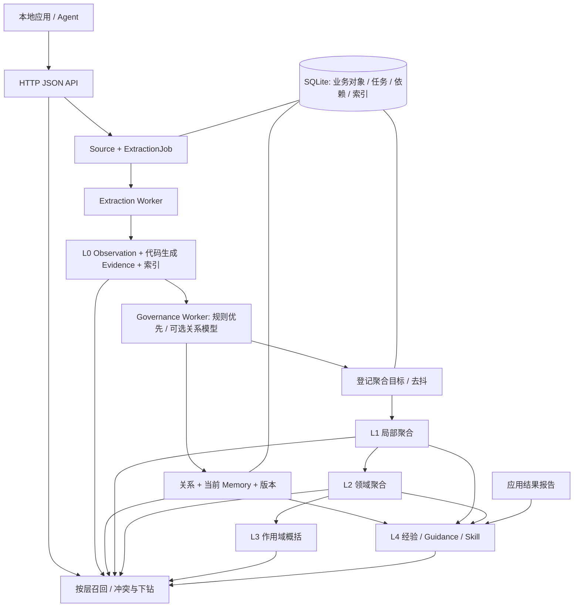

# 系统 AI 记忆服务架构设计（v2）

[文档索引](README.md) · [技术与使用指南](technical-guide.md)

本文整合架构优化设计与实施决策，作为当前系统的架构基线。核心变化是将记忆形成、治理和
聚合拆成三个异步阶段，明确 Source、Observation、当前 Memory 和 Derived Memory 的边界。
具体 HTTP、模型和存储字段分别见 [API 决策](contracts/api-decisions.md)、
[模型协议](contracts/model-provider.md)和[存储契约](contracts/storage.md)。

本文区分当前实现与后续规划；复杂时间注释、查询/显式触发聚合和大规模容量验证不因写入设计
而视为已经实现。项目尚未发布，当前结构面向全新数据库，不提供旧协议或旧数据库升级流程。

## 一、服务定位与核心原则

`dmemd` 是 Go 实现的轻量级、用户级长期记忆服务，采用单进程、模块化架构，HTTP、后台
Worker 和生命周期管理共享 SQLite。每个操作系统用户、同一数据目录只运行一个实例。

- 默认监听 `127.0.0.1:18432`，配置只允许回环地址；没有认证或应用间 ACL。
- 同 UID 应用共享全部记忆；`app_id`、`scope_key` 和消息 role 不是身份或权限凭据。
- 文本、对话和结构化内容统一通过 `POST /v1/ingestions` 接收，不提供直接内容写入捷径。
- Source 接收成功即持久化；提取失败不丢 Source，治理失败不丢已形成的 Observation。
- 模型只识别内容、判断有限语义关系或生成派生正文；代码负责来源绑定、ID、版本、状态、
  关系落库、依赖和任务。模型不能返回数据库动作或决定持久化目标。
- 不确定性是正常业务状态：保留 pending/unresolved，不按接收顺序覆盖旧结论。
- 高层内容只能作为派生视图，不能反向写成 Observation 或事实来源。
- 原文清除、撤回和永久遗忘沿显式依赖传播；失效立即退出默认召回，重建可以去抖。

## 二、对象模型与总体架构

### 2.1 四类核心对象

| 对象 | 语义 | 来源与重建边界 |
| --- | --- | --- |
| Source | 调用方提交的原始 JSON、scope 和来源元数据 | 原始依据；不能由摘要恢复，显式清除除外 |
| L0 Observation | 一次 Source 中可独立保留的原始观察 | 可从仍保留的 Source 重新提取；不等于已确认事实 |
| Canonical Memory（代码名 `Memory`） | 规则和治理物化的当前规范视图 | 依赖 Observation、关系和显式裁决；不是首次提取结果 |
| Derived Memory（HTTP 路径保留 `artifacts`） | L1–L4 摘要、画像、经验与指导内容 | 可失效、可重建，版本保存精确 typed dependencies |

箭头表示数据流，不代表 Worker 互相同步调用。阶段通过持久化任务交接；聚合由独立
Aggregation Worker 执行，另有独立 Embedding Worker。所有模型调用都在写事务之外。

### 2.2 模块职责

| 模块 | 职责 |
| --- | --- |
| `transport/http`、`jobs` | HTTP DTO、路由、错误映射；按阶段展示任务，不执行治理 |
| `source` | 原始来源、确定性 segment 视图、代码证据绑定与原文清除 |
| `ingest`、`extraction` | 接收事务、提取调度、分块模型调用、仅保存 L0 |
| `observation` | L0 类型、extractive/normalized 正文、Evidence 构造和只读查询 |
| `governance` | 规则匹配、最小关系判断、当前视图物化、分类、冲突复查、撤回与遗忘 |
| `memory` | 当前规范视图、版本、证据、生命周期及内部统一 Writer |
| `aggregation` | L1/L2/L3 与 L4 的输入选择、去抖生成和逐层任务登记 |
| `artifact`、`skill` | 派生对象、版本、依赖、失效、目标状态及指导型 SKILL.md 渲染 |
| `retrieval`、`embedding` | 分层关键词召回、当前 Memory 混合检索、向量后台任务与降级 |
| `model` | 窄能力远端协议适配；不拥有业务状态或写数据库 |
| `store/sqlite` | SQL、短事务、schema、索引、任务和依赖持久化 |
| `runtime`、`webui` | 配置/锁/启动恢复/Worker 监管；可选内嵌管理台 |

HTTP 调用业务能力接口，业务模块依赖存储端口和模型端口；SQL 集中在 `store/sqlite`。
不为每张表建立业务服务，也不用一个完整领域对象兼任三阶段模型协议。独立分类结果尚未接通，
当前 classify handler 只是任务完成边界，不代表已保存自动标签。

## 三、原始记忆形成与代码证据

### 3.1 统一接收与提取

1. HTTP 解码 JSON，在同一事务保存 Source 和 queued ExtractionJob，返回 `202`、
   `source_id` 和 `job_id`；不读 Memory、不调用模型。
2. Extraction Worker 构造确定性 source segments，长输入按有界窗口调用提取模型。
3. 模型只返回 `items[{span_ids, kind?, content?}]`；首次提取不读取历史 Memory、不合并、
   不裁决冲突、不计算时间区间、不生成摘要。
4. 代码绑定 span、生成 Observation/Evidence，执行同一 Source 内的精确去重。
5. 短事务重新检查任务与 Source，原子保存 Observation、Evidence、L0 索引、
   `govern_observation` 任务和提取结果。只有 observed Observation 自动登记治理任务。

重复提交仍创建不同 Source/任务，没有摄取请求幂等承诺；跨 Source 的重复由治理处理。
提取任务 `succeeded` 只表示 L0 阶段完成，不表示 Memory 已物化或高层聚合已生成。

### 3.2 Observation 与 Evidence

Observation 保存 `id/source_id/scope_key/kind/content/content_mode/origin_role/status/`
`extraction_version/created_at/updated_at`。kind 为 `fact/preference/event/procedure`，
状态为 `observed/pending/retracted/deleted`。

- `extractive`：正文直接取自被选中的 Source spans，是默认方式。
- `normalized`：仅在原文不能独立表达时使用模型整理正文；正文与证据原文明确分开。
- segment ID 在同一 Source 重试中稳定，保留字段路径、rune 范围、消息 role/时间等来源信息；
  segments 由代码重建，不额外保存一套原文表。
- Evidence ID、source/segment/message 关联、quote、location 和时间全部由代码生成。
  模型只选临时 span ID，不能提供可落库 evidence、quote 或 offset。
- 未知或 context-only span 不模糊恢复；有可保留 normalized 正文但绑定失败时保持 pending，
  不自动治理；没有可用原文或正文的草稿不保存。normalized content 永远不当作 quote。
- 同一 Source 内相同 span 集合与相同正文只保存一条；不同正文即使引用同一 span 也分别保留。

## 四、异步治理与当前记忆视图

### 4.1 规则优先，模型只判断关系

治理读取已保存 Observation、同 scope 的有限候选 Memory、引用、关系与必要证据摘要。
精确重复、已物化重放、scope 不匹配、删除/撤回保护等先由确定性规则处理；没有候选时直接
按 independent 物化。规则不能确定且存在候选时，才调用关系模型。

关系词汇固定为 `duplicate/supports/enriches/supersedes/contradicts/separate/independent/`
`unresolved`。模型只使用 `new/existing_N` 临时引用；服务映射真实对象并校验状态后落库。

| 关系 | 当前物化行为 |
| --- | --- |
| duplicate / supports | 关联新 Observation 到已有 Memory 当前版本，不改正文、不递增版本 |
| enriches | 由代码组合补充正文，生成新 revision 和完整 Observation 引用 |
| independent / separate | 创建独立 Memory，不改已有对象 |
| supersedes | 当前保守实现创建新 Memory 并记录替代关系，旧对象不物理删除、不自动关闭时间区间 |
| contradicts / unresolved | 保留原观察，物化 pending，不覆盖既有 accepted 结论 |

关系是持久化的语义记录，新增/修订等数据库动作由物化器执行。模型输出、accepted 和
应用报告都不构成客观真实性认证。归档/删除/rejected 目标不得被后台静默重新激活。

### 4.2 当前 Memory、版本与冲突

当前 Memory 只保存 ID、kind、标题/正文、`state`、`assertion_status`、version、scope、首次
来源和记录时间。正文/断言/生命周期变化生成完整新版本；治理补充来源引用可以不改正文版本。
历史恢复复制旧快照形成新的 active 版本，保留原断言状态，清除过的 evidence 不恢复原文。

普通 Memory 召回先 accepted、再明确标记 pending；rejected 不召回。pending 或相关 open
冲突附 `fact_conflict`。typed relations 与冲突成员/审计独立保存，不能把 pending 当作已确认事实。
当前关系治理不保证每条矛盾自动创建一条冲突记录；显式冲突管理保留 choose/reject_all。

人工裁决必须携带 conflict revision 和全部成员当前版本，过期返回 `409`；裁决和版本变化
在同一事务提交。自动复查不调用模型，只处理成员集合本身可证明的单一 active accepted
或相同正文收敛等情况，其余保持 open，不依赖接收顺序或模型置信度。

### 4.3 时间边界

当前规范模型不保存 `observed_at/event_time/valid_from/valid_to`、时间 basis、事实组、
durability/phase、结构化 procedure、qualifiers 或内嵌 topics。`procedure` 仍是基础 kind，
不表示存在结构化流程字段；分类标签不由首次提取输出。

Source 接收时间、segment 的 `occurred_at` 元数据和正文/evidence 中的自然语言时间表达
继续保留。记录时间不能当作事实更新时间。当前不支持 `as_of/event_at` 过滤或时间线裁决；
未来时间能力通过独立 Temporal Annotation 任务实现，不重新成为 L0 写入前置条件。

## 五、L1–L4 聚合与依赖图

| 层 | 输入 | 产物与范围 |
| --- | --- | --- |
| L1 局部聚合 | 同 scope、代码生成 bucket 中的 Observation | local_summary |
| L2 领域聚合 | active L1 | topic_summary；类型模型也保留 profile |
| L3 全局聚合 | active L2 | scope_summary；“全局”不授予跨 scope 权限 |
| L4 指导层 | 稳定 Memory、相关低层派生对象及应用结果 | experience_case、guidance、skill |

这不是单树：同一输入可以参与多个目标。每个版本在 `derived_dependencies` 保存
`observation/memory/derived/experience` 的精确 ID、版本和 required 标记；不允许反向或循环依赖。
L2/L3 不绕过下层读取全库 L0，L4 Skill 不读取未经治理的全部 Observation。

当前自动领域默认 general，独立分类结果尚未驱动细粒度主题/画像生成；保留 kind 不等于
对应的完整产品能力已经落地。

普通变化登记目标并去抖：治理提交登记 L1，L1 提交登记 L2，L2 提交登记 L3；稳定 procedure
和应用报告驱动 L4。当前使用变化触发和周期对账；数量阈值、查询触发及显式生成 API 属于
后续扩展，在线召回不等待模型。

模型只生成聚合正文；标题、target、层级、版本、依赖、hash、生成器/协议版本和 truncated
由代码确定。输入受条数/字数预算限制，下层不完整或输入截断必须传递不完整标记，不把依赖
存在当作语义完整证明。相同输入签名避免重复生成。

派生对象当前状态为 `active/stale/disabled`；只有 active 当前版本默认召回，stale 历史显式
读取。下层变化沿依赖图递归失效，先退出召回再重建。没有合法输入时 disabled，无合格输入的
新目标只记录评估，不创建空对象。

经验结果是应用报告（success/failure/unknown/partial_success），可选 run_id 去重，不能被模型
升级为已验证执行。失败/撤销使相关指导失效。Skill 需有稳定 procedure 等合格依据，仅提供
可修正的 SKILL.md，不修改配置、不授权工具、不生成或执行脚本。

## 六、存储、事务与任务调度

采用 `database/sql` 与纯 Go `modernc.org/sqlite`，WAL、外键、FULL 同步、单写连接和小型
只读池。数据目录权限 `0700`，数据库、伴随文件与凭据文件 `0600`。索引是可重建派生数据。

| 短事务 | 原子提交内容 |
| --- | --- |
| 接收 | Source + queued ExtractionJob |
| 提取 | Observation + Evidence/关联 + L0 索引 + 治理任务 + 提取结果 |
| 治理 | typed relations + 当前 Memory/版本/引用/索引 + 后续目标 + 任务结果 |
| 聚合 | 派生版本/当前指针 + 精确依赖/索引 + 上一层任务 + 当前任务结果 |
| 撤回/清除 | 来源/观察状态、索引移除、递归依赖失效、取消/重排任务 |

模型、网络和长计算全部在事务外。提交前重新检查任务 revision、输入签名/版本及来源/目标状态；
旧结果只能丢弃或重排，不能覆盖新输入或复活已删除内容。各阶段最终一致，不提供整条金字塔
同步完成的承诺。具体表与迁移契约见[存储契约](contracts/storage.md)。

Extraction、Governance、Aggregation、Embedding 各有单个顺序 Worker，互不调用处理函数。
治理/聚合共享 `governance_jobs`，但按 kind 领取各自任务；`(kind,target_key)` 唯一，输入变化
递增 revision 并合并待办。删除/撤销不等待普通去抖，阶段故障不阻断 HTTP 和已有底层查询。

摄取/治理任务状态为 queued/running/waiting/succeeded/failed/cancelled。网络、超时和限流
按默认 5 秒、30 秒、2 分钟后继续退避，最长 30 分钟；连续协议失败默认 3 次后隔离。
配置/凭据错误等待重启重评。启动重排遗留 running，不引入租约、分布式队列或第二套状态账本。
任务展示将调度 status、业务 stage、质量和 reason_code 分开，不用“成功”掩盖下游未完成。

## 七、分层召回与检索

唯一入口 `POST /v1/memories/recall` 返回六个独立分区：
`observations/memories/l1/l2/l3/l4`，附 conflicts、warnings 和可选 relations/diagnostics。

- `layers` 显式列表优先；省略时由 `query_mode` 选择：overview=L1/L2/L3，detail=L0/Memory，
  history/conflict=L0/Memory 加关系，guidance=L4，未指定则全层。history 不是历史时点快照。
- 每层独立 Top-K（默认 20，上限 100），分数不跨层相加，不将高层摘要冒充原文。
- scope 指定时包含该 scope 和 `user`，不是权限过滤。
- 当前 Memory 支持 keyword/hybrid；L0 与派生层固定关键词，不建立全层向量队列。
- stale 默认排除；显式 `derived_states` 可读取标记为 stale 的参考。相关高层只有 stale 命中
  且没有 active 命中时可回退下层，附 `derived_stale_fallback`，不调用聚合模型。
- 依赖提供精确下钻路径；跨层内容不承诺语义去重。max_context_tokens 使用保守 rune 估算，
  超预算截断并附 `context_budget_truncated`。

关键词使用共享 NFC/大小写规范化、中英文词典分词、受控停用词及安全参数绑定，统一 any/OR
匹配，不暴露 FTS 语法或 all 开关；空白/标点/仅停用词返回空结果。当前 Memory 按加权
BM25（标题/正文 4:1）取候选并结合覆盖率重排。hybrid 增加独立 Embedding 余弦候选，以 RRF
融合；500 ms 查询子预算失败时降级关键词并给稳定 warning。排序分数不是事实置信度。

## 八、生命周期、撤回与永久遗忘

Memory 的 active 默认可召回，archived 需显式请求，deleted 墓碑不进检索；无自动到期。
Observation 的 retracted/deleted 不进入默认 L0 召回，正文不能通过 HTTP 直接编辑。

- 来源原文清除：同事务清空 Source content 和全部 Evidence quote/location，取消未完成
  摄取任务并清理错误摘要；当前 runtime 还撤回关联 Observation、取消治理并递归失效派生。
  Memory 无其他合法 Observation 支持时逻辑删除，否则保留正文。此操作不等于物理擦除。
- 普通归档/删除：保留审计和历史，使显式依赖失效，不猜测“同事实”副本。
- 单条 purge：永久清除该 Memory 与其专属数据，共享 Source/Observation 不随之全部删除。
- `POST /v1/forget`：按 memory/source/experience 显式范围，在一个事务内展开来源关联、历史
  evidence 和依赖影响并清理。只沿显式关系/依赖传播，不再计算事实组或时间区间重复闭包。
  依赖失效与历史物理清理是不同操作，具体边界见存储契约。
- 仍有合法输入的目标排队重建，没有输入的 disabled；在途任务提交前重查状态。高层正文
  不能作为恢复已遗忘底层数据的依据。

## 九、HTTP、运行与验证边界

HTTP/1.1、UTF-8 JSON、snake_case、UTC RFC 3339。Authorization 可省略且不验证，不要求
签名、幂等键或通用版本请求头；冲突裁决单独携带版本字段。业务能力会校验可识别枚举、查询
边界、裁决和内部一致性，不能将“无认证”误写为“完全无校验”。错误以普通 HTTP 状态码和
`{"error":"...","code":"..."}` 返回，可选 code 用于固定原因。

主要接口包括 ingestions、observations、memories/recall、Memory 生命周期/历史、conflicts、
artifacts/targets、experiences、sources、jobs/governance-jobs、Embedding 诊断和健康检查。
普通列表只有 limit；artifacts/targets 单独支持 cursor/next_cursor。完整路径以
[OpenAPI](../api/openapi.yaml)和[API 决策](contracts/api-decisions.md)为准。

启动顺序：配置 → 私有目录/单实例锁 → SQLite/schema → 恢复任务 → 各 Worker → HTTP。
关闭停止接收、取消模型等待并结束事务。`/healthz` 检查存活，`/readyz` 只检查数据库就绪；
模型不可达不使已有记忆查询失效。可选管理台由带 `webui` tag 的 Go 二进制托管于 `/ui/`。

验证应分别覆盖 L0 形成、代码锚定、规则/关系治理、逐层依赖、stale 回退、撤回竞态和事务回滚，
并分别统计模型调用/token、pending/stale 年龄、失败与重试，不仅统计最终 Memory 数量。
当前测试入口及 legacy 测试边界见[测试文档](testing.md)。旧版一万条容量和离线质量记录不能
推导 v2 已验收；真实模型语义质量、新分层容量、十万条、长期负载及备份恢复需独立验证。
服务尚无自动备份/恢复，不承诺外部副本撤销、远端模型擦除或取证级物理删除。
