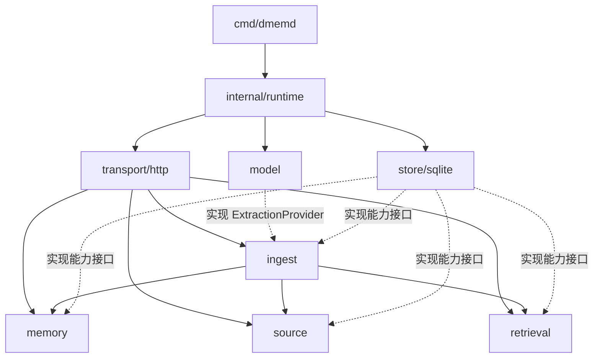

# 目录结构与模块划分

## 1. 结构原则

依据《系统 AI 记忆服务架构设计.md》（v1），采用单 Go Module、单进程、按能力划分的内部模块。P1 已创建 Go Module、命令入口、领域类型/能力接口、配置/日志、运行骨架、健康检查、测试与契约文档；P2 已完成真实 SQLite 连接、顺序迁移、业务表、外部内容 FTS5 触发器、短事务、来源/任务存取和测试设施；P3 已完成内部记忆写入/版本/证据、归档/删除/恢复/永久清除、来源查询与原文清除服务；P4 已完成 NFC/中文分词、生产搜索文档构造器、安全 FTS 编译、过滤与 BM25 排序、摘要/证据/解释、索引重建及后台相关 active 记忆查询；P5 已完成统一接收、远端模型协议适配与容错解析、相关上下文编排、自动合并、原子结果提交、单 Worker、三次尝试、启动恢复及清除/崩溃竞态验证；P6 已完成全部 HTTP 路由/DTO、统一错误响应、完整进程组装、数据目录单实例锁、优雅关闭、curl 调用示例和 HTTP/进程级回归测试。P7 暂缓。目录树仍展示完整目标；`backup.go`、容量测试、运维手册、用户级部署模板及发布产物等 P7 专属内容留待后续创建。`docs/performance.md` 当前只编写测试规格，实测报告留待 P7。

业务模块不依赖 HTTP DTO 或 SQLite 驱动；SQL 只在存储模块。接口由使用方按能力定义，具体实现由 `runtime` 组装，不为每张表创建业务服务，不引入通用 Repository 框架。

## 2. 目标目录树

```text
dmemd/
├── 系统 AI 记忆服务架构设计.md     # 原始架构依据
├── tech-stack.md                 # 技术、环境、版本及运行约束
├── project-structure.md          # 本文件
├── plan.md                       # 里程碑、依赖和验收门禁
├── tasks.md                      # 可独立执行的原子任务
├── README.md                     # 构建、运行和文档入口
├── LICENSE
├── go.mod
├── go.sum
├── .go-version                   # 开发与 CI 的精确 Go 版本
├── .gitignore
├── Makefile                      # 统一格式检查、测试和发布构建入口
├── cmd/
│   └── dmemd/
│       └── main.go               # 启动和本地维护命令入口
├── internal/
│   ├── idgen/
│   │   └── idgen.go             # 统一 UUID v4 生成
│   ├── memory/
│   │   ├── types.go              # 记忆、版本、状态和操作类型
│   │   ├── ports.go              # MemoryService 及所需存储能力
│   │   ├── service.go            # 统一记忆写入和查询
│   │   ├── lifecycle.go          # 归档、删除、恢复、永久清除
│   │   └── evidence.go           # 版本完整证据集合及支持关系
│   ├── source/
│   │   ├── types.go              # 原始 JSON 内容、来源及证据定位
│   │   ├── ports.go
│   │   ├── locate.go             # 证据片段定位与证据构造（rune 偏移）
│   │   └── service.go            # 来源查询、原文清除和任务取消
│   ├── ingest/
│   │   ├── types.go              # 任务、候选、处理决策与结果
│   │   ├── ports.go              # IngestService、ExtractionProvider 等能力接口
│   │   ├── service.go            # 来源与任务原子接收、任务查询
│   │   ├── processor.go          # 提取、相关记忆检索及合并编排
│   │   ├── merge.go              # 新增、更新、补证、跳过规则
│   │   └── worker.go             # 单 Worker、重试、恢复和取消
│   ├── retrieval/
│   │   ├── types.go              # 查询、过滤、结果和解释信息
│   │   ├── ports.go              # SearchService 与搜索存储能力
│   │   ├── normalize.go          # 文档和查询共用规范化、分词
│   │   ├── query.go              # 安全编译普通文本为 FTS 表达式
│   │   ├── service.go            # 过滤、Top-K 和排序编排
│   │   └── snippet.go            # 从原正文提取可读摘要
│   ├── model/
│   │   ├── remote.go             # 实现 ingest.ExtractionProvider
│   │   ├── protocol.go           # 首个远端模型协议映射
│   │   └── parse.go              # 候选解析、辅助字段默认值
│   ├── store/
│   │   └── sqlite/
│   │       ├── store.go          # database/sql 连接、初始化和关闭
│   │       ├── tx.go             # Store.WithTx 与事务作用域能力
│   │       ├── migrate.go        # 内嵌顺序迁移及 schema_migrations
│   │       ├── memories.go      # 当前快照和版本 SQL
│   │       ├── sources.go       # 来源与证据 SQL
│   │       ├── jobs.go          # 持久化任务与状态转换 SQL
│   │       ├── search.go        # 搜索文档、FTS5、排序及重建
│   │       ├── backup.go        # P7 暂缓：一致性备份与恢复检查
│   │       └── migrations/
│   │           ├── 0001_core.sql
│   │           └── 0002_search.sql
│   ├── transport/
│   │   └── http/
│   │       ├── handler.go       # net/http 路由，不安装认证中间件
│   │       ├── dto.go           # JSON 请求与响应
│   │       ├── request.go       # 宽松参数解析与默认值
│   │       ├── response.go      # 通用响应及简单错误映射
│   │       ├── memories.go      # 统一提交与记忆管理
│   │       ├── search.go        # POST 检索
│   │       ├── sources.go       # 来源查询与清除
│   │       ├── jobs.go          # 任务状态查询
│   │       └── health.go        # healthz / readyz
│   ├── runtime/
│   │   ├── config.go            # 配置、用户目录和运行参数
│   │   ├── app.go               # HTTP/Worker 生命周期和优雅关闭
│   │   ├── services.go          # 业务服务、模型、Worker 完整组装
│   │   ├── instance.go          # 用户数据目录单实例进程锁
│   │   └── logging.go           # 请求/任务日志及敏感内容处理
│   └── testutil/
│       ├── sqlite.go            # 隔离的真实 SQLite 测试环境
│       └── model.go             # 可控成功、失败和阻塞模型
├── tests/
│   ├── integration/             # 跨模块事务与 HTTP 契约集成测试
│   ├── e2e/                     # 真实进程启动、单实例、SIGTERM 与重启恢复
│   ├── benchmark/               # P7 暂缓：十万条数据及容量测试
│   └── testdata/                # 无真实用户内容的输入与预期输出
├── configs/
│   └── dmemd.example.json       # 不含真实凭据的配置示例
├── api/
│   └── openapi.yaml             # HTTP 契约；仅文档，不生成校验层
├── docs/
│   ├── dependency-baseline.md   # 精确版本、SQLite 能力与构建平台
│   ├── contracts/
│   │   ├── api-decisions.md     # 架构未展开的接口细节
│   │   ├── model-provider.md    # 远端模型协议与解析策略
│   │   └── storage.md           # SQLite 连接、迁移、表与事务契约
│   ├── testing.md               # 测试命令、隔离和故障注入方法
│   ├── operations.md            # P7 暂缓：部署、备份、恢复和排障
│   └── performance.md           # 当前编写规格与预算；P7 补充实测报告
├── scripts/                     # 必要的构建、测试、维护薄包装
├── packaging/                  # P7 暂缓：用户级部署模板
│   └── systemd/
│       └── dmemd.service        # Linux 用户级服务模板
└── <CI 配置目录>/               # T1.6 按仓库托管平台确定
```

文件拆分可按实现规模合并，但必须保持上述模块边界。单元测试紧邻被测文件，命名为 `*_test.go`；跨模块测试进入 `tests/`。不为占位而创建空包。

## 3. 核心模块职责与边界

| 模块 | 负责 | 边界与协作 |
| --- | --- | --- |
| `cmd/dmemd` | 命令入口、退出码、启动或维护模式选择 | 不承载 HTTP、领域规则或 SQL |
| `transport/http` | 路由、JSON 解码、调用服务、响应和错误映射 | 不认证、不检查业务字段，不在 HTTP 中调用远端模型或执行 SQL |
| `memory` | 快照、完整版本、证据集合、状态和恢复、统一写入事务规则 | 内部允许新增/更正；公开 HTTP 的新增/更正必须经 ingest |
| `source` | 来源、证据定位、查询、显式原文清除 | 清除与任务取消共事务；不自行重新提取记忆 |
| `ingest` | 统一接收、任务状态、单 Worker、候选提取与自动合并 | 通过模型接口及记忆/检索能力工作，不创建独立写入 API |
| `retrieval` | 共用预处理、关键词查询、过滤、排序、摘要和解释 | 不修改事实、不增加语义推断或同义词扩展 |
| `model` | 远端协议适配、超时、候选解析与默认值补齐 | 不持有数据库、不自行落库；不接收无关来源或完整记忆库 |
| `store/sqlite` | 数据表、迁移、连接、事务、FTS、任务持久化和备份 | 不决定业务合并策略，不在事务中发起模型请求 |
| `runtime` | 配置、依赖注入、单实例、启动顺序、日志、关闭协调 | 调度器在此启动，状态机由 ingest 定义，模型故障不阻断读取 |
| `internal/testutil` | 假模型、真实临时数据库和故障控制 | 仅测试使用；不进入生产依赖图 |

## 4. 依赖关系与接口归属



图中实线表示调用/组装方向，虚线表示适配器实现消费方接口；业务不反向导入具体适配器。`runtime` 可以导入各模块进行组装。存储可复用 `retrieval` 的纯规范化函数来生成索引文本，`retrieval` 不导入存储实现，以免环依赖。

| 关键接口 | 建议归属 | 输入 / 输出与责任 |
| --- | --- | --- |
| `IngestService` | `internal/ingest/ports.go` | 接收任意合法 JSON 内容及可选来源信息，返回来源/任务标识；查询任务结果 |
| `MemoryService` | `internal/memory/ports.go` | 内部写入、管理列表、当前/历史读取、状态变更、恢复和永久清除 |
| `SearchService` | `internal/retrieval/ports.go` | 普通关键词与过滤条件，输出 Top-K、分数、证据引用及可选解释 |
| `ExtractionProvider` | `internal/ingest/ports.go` | 输入当前提交与相关记忆上下文，输出可处理候选；`model` 实现 |
| `Store.WithTx` | 业务所需事务能力接口；实现位于 `store/sqlite/tx.go` | 执行短事务并暴露同一事务作用域的读写能力，保证跨表及任务结果原子性 |

具体 Go 签名在 T1.7 固定；事务回调不得让业务依赖 `*sql.Tx`。Worker 提交结果时复用 memory 的变更逻辑与已打开事务，禁止嵌套事务或各模块自行提前提交。

## 5. 数据归属与原子边界

| 数据 | 逻辑归属 | 必须一起完成的操作 |
| --- | --- | --- |
| `memories`、`memory_revisions` | memory | 当前快照更新、新版本、完整证据集合、索引更新 |
| `sources` | source | 接收时与 `ingest_jobs` 一起插入；清除时保留标识与 `redacted` |
| `evidence`、`revision_evidence` | source / memory 协作 | 定位由 source 负责；版本完整集合由 memory 负责；清除覆盖历史引用 |
| `ingest_jobs` | ingest | 成功结果与所有记忆变更一起提交；来源清除时取消关联未完成任务 |
| `memory_search_docs`、`memory_fts` | retrieval 定规则、store 实现 | 未删除记忆同步索引，归档保留索引，删除移除，恢复重建条目 |
| `schema_migrations` | store/sqlite | 迁移版本与结构变更按迁移策略一致记录 |

所有 SQL 表的物理操作仍集中在 `store/sqlite`，逻辑归属不意味着每表一套服务。

## 6. 主数据流

1. **统一提交**：HTTP 解码 → ingest → 同一事务写入 source 与 queued job → 返回 `202`。没有独立来源创建或直接记忆写入路由。
2. **后台处理**：单 Worker 取任务 → 整理当前输入并按关键词寻找相关 active 记忆 → 事务外调用模型与计算候选 → 决定新增/更新/补证/跳过 → 短事务检查取消状态、更新快照/版本/证据/索引并标记成功。若具体远端协议需要两步提取与整理，每次调用都只带当前输入和相关上下文，均受超时约束。
3. **检索**：HTTP → retrieval 共用规范化与安全查询编译 → SQLite FTS5 与结构化过滤 → BM25/时间/ID 排序 → 原文摘要、命中词与当前证据引用。
4. **原文清除**：HTTP → source → 同事务清除 sources 原文及全部关联证据原文副本、设置 redacted、取消未完成任务。若模型调用已发出，结果提交事务发现 cancelled 后不落库。
5. **重启恢复**：runtime 初始化配置/目录/连接/迁移 → ingest 把 running 重排 queued 并保留尝试计数 → 启动一个 Worker 和 HTTP；已成功任务不重跑。

## 7. 非代码资产边界

`api/openapi.yaml` 固定协议，不用于生成认证或业务校验。`configs/` 只存示例。`tests/testdata/` 不存真实对话或凭据。用户数据库、WAL/SHM、凭据文件、备份、构建产物和本地性能数据均不入库。`docs/` 的运行手册与性能报告由对应任务创建；不创建前端工程或外部消息服务目录。
