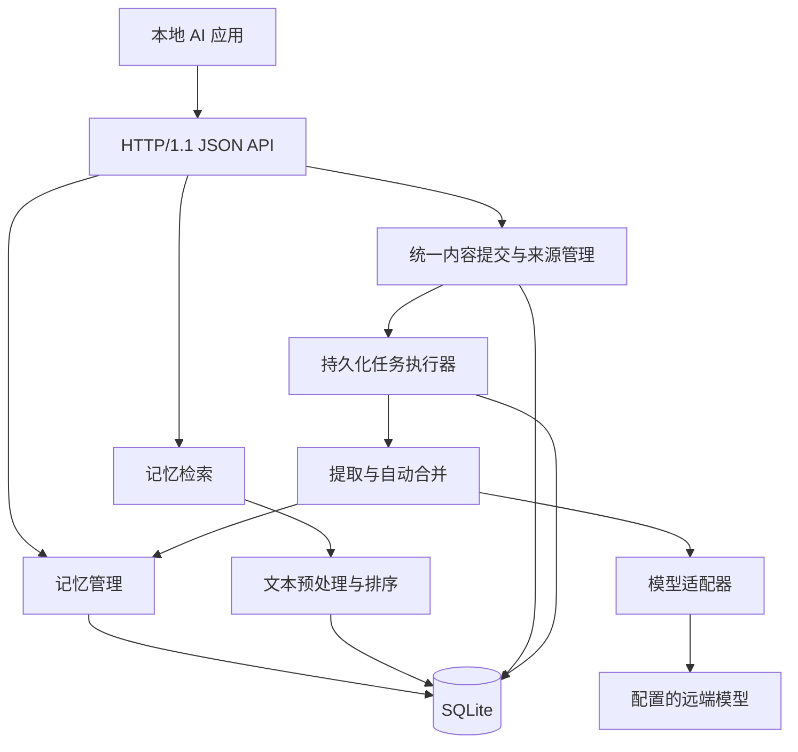

# 系统 AI 记忆服务架构设计（v1）

## 一、总体架构与模块划分

### 服务定位与设计边界

`dmemd` 是使用 Go 实现的轻量级用户系统 AI 记忆服务，为同一操作系统用户的多个 AI 应用提供统一的长期记忆能力。应用只负责提交内容，由服务统一完成整理、提取、合并和持久化。

采用以下已确认的设计前提：

- 每个操作系统用户运行一个服务实例，本地应用共享全部记忆，允许跨应用读取和修改，不设置应用准入或认证流程。
- 所有对话、事件、自然语言描述和已有结构化内容使用同一个提交接口，不区分直接写入和模型自动写入。
- 自动提取优先使用配置的远端模型，允许自动新增和更新记忆。
- 首版实现关键词检索、结构化过滤和可解释排序。
- 以十万条以内有效记忆、少量应用并发为设计规模。
- 原始输入默认保留在本地，支持显式清除。

采用**单进程、模块化架构**：HTTP 服务、后台任务和生命周期管理运行在同一进程，业务数据与任务队列统一保存在 SQLite 中。

接口不设置业务写入校验、条件请求、请求幂等协议或分页协议。仅保留正常处理所需的 JSON 解码、存储事务和执行错误反馈。



### 模块职责

| 模块             | 职责                                                         |
| ---------------- | ------------------------------------------------------------ |
| `transport/http` | 路由、JSON 编解码、调用业务模块和错误响应；不做身份认证、安全校验或业务字段校验 |
| `memory`         | 创建、更新、删除、恢复、版本管理、生命周期规则与统一写入事务 |
| `source`         | 原始对话和事件管理、证据定位、原文清除                       |
| `ingest`         | 统一内容接收、任务编排、候选生成、内容合并和自动更新         |
| `retrieval`      | 查询规范化、关键词匹配、过滤、排序和结果组装                 |
| `model`          | 模型调用接口、远端协议适配和结果解析                         |
| `store/sqlite`   | SQL、事务、迁移、全文索引、持久化任务                        |
| `runtime`        | 配置、启动关闭、任务调度、日志和健康检查                     |

依赖方向为 HTTP → 业务模块 → 存储或模型接口。SQL 集中在存储模块；模型结果由服务内部解析和整理后保存，不增加独立的业务校验层。

关键内部接口按能力划分为 `IngestService`、`MemoryService`、`SearchService`、`ExtractionProvider` 和 `Store.WithTx`。不为每张表单独创建一套业务服务。

## 二、记忆存储、版本证据与生命周期

### 记忆数据模型

一条记忆表达一个可以独立更新、检索和追溯的事实、偏好、事件或操作经验。以下为服务处理后的存储模型，不要求调用方在提交内容时提供这些字段。

| 字段                       | 含义                                                         |
| -------------------------- | ------------------------------------------------------------ |
| `id`                       | 服务生成的 UUID，生命周期内不变                              |
| `kind`                     | `fact`、`preference`、`event`、`procedure`                   |
| `title`                    | 简短标题                                                     |
| `content`                  | 面向应用使用的自然语言记忆正文                               |
| `state`                    | `active`、`archived`、`deleted`                              |
| `version`                  | 从 1 开始、逐次递增的整数                                    |
| `observed_at`              | 事实或来源事件发生时间，用于处理新旧信息                     |
| `created_at`、`updated_at` | 服务端记录时间                                               |

记忆以 `id` 标识。服务根据内容、关键词和相关记忆判断重复或更新关系，不要求调用方构造全局唯一的逻辑标识。记忆不设置自动到期机制。

### 持久化方案

采用 `database/sql` 与 `modernc.org/sqlite`，减少部署时对 CGO 工具链的依赖；该驱动提供不依赖 CGO 的 SQLite 实现。依赖版本在实现时固定，并通过集成测试验证 FTS5 能力。([pkg.go.dev](https://pkg.go.dev/modernc.org/sqlite))

主要表如下：

| 表                                 | 内容与约束                                                   |
| ---------------------------------- | ------------------------------------------------------------ |
| `memories`                         | 当前快照，以 `id` 为主键                                    |
| `memory_revisions`                 | 每次变更的完整快照、操作类型和原因；唯一键为 `(memory_id, version)` |
| `sources`                          | 每次提交的原始内容、可选应用标识、可选外部标识和接收时间     |
| `evidence`                         | 来源引用、可选消息标识、原文片段和定位信息                   |
| `revision_evidence`                | 某一记忆版本与证据之间的关联                                 |
| `memory_search_docs`、`memory_fts` | 可重建的规范化搜索文档与 FTS5 索引                           |
| `ingest_jobs`                      | 内容处理任务、状态、重试次数、错误和结果摘要                 |
| `schema_migrations`                | 数据库结构版本                                               |

持久化约定：

- 数据默认放在用户数据目录下，目录权限 `0700`，数据库和凭据文件权限 `0600`。
- 启用 WAL、外键、`synchronous=FULL` 和有界等待；所有连接统一初始化。
- 使用单写连接和小型读连接池。SQLite WAL 支持读写并行，但同时只有一个写事务，因此模型调用和长时间计算必须放在事务之外。([sqlite.org](https://www.sqlite.org/wal.html))
- 当前快照、版本、证据关联和全文索引在同一个事务内提交。
- 索引是派生数据，业务表是事实来源；迁移或索引规则变化后可重建。
- 备份通过 SQLite 一致性备份机制完成，恢复时停止服务、恢复数据库、检查结构并校验索引。([sqlite.org](https://www.sqlite.org/backup.html))

### 版本与证据

每次内容、状态或证据集合变更都生成新版本。版本仅用于追溯和恢复，不作为接口调用的前置条件。恢复旧版本时，复制其内容生成一个新版本。

所有提交内容都保存来源记录，生成的记忆通过 `source_id` 关联原始输入，可以附带消息标识、原文片段和模型名称。引用片段能够定位时记录位置，无法定位时保留来源关联即可，不因此拒绝整批内容。调用方不需要构造或提交证据。

新版本保存其完整证据集合。更正事实时，不把支持旧结论的证据直接继承为新结论的支持证据；旧证据仍可通过历史版本查询。

### 生命周期

| 状态       | 含义                     | 默认检索             |
| ---------- | ------------------------ | -------------------- |
| `active`   | 当前有效                 | 返回                 |
| `archived` | 主动归档                 | 不返回               |
| `deleted`  | 逻辑删除，保留墓碑和历史 | 不返回               |

具体规则：

- 创建后默认 `active`，由应用主动归档或删除，不运行到期维护任务。
- 归档、删除和恢复均生成版本；恢复后可以重新进入默认检索。
- 后台整理默认只合并 `active` 记忆，不自动恢复已归档或删除的记录。
- 普通删除保留历史；显式永久清除时，删除当前记录、历史、专属证据和索引，共享来源不随之删除。
- 清除来源原文时，同时清除其证据引用中的原文副本，保留来源标识和 `redacted` 状态；已形成的记忆正文继续保留。版本不可变规则对这种显式清除操作作例外处理。

## 三、统一内容提交与处理流程

### 统一提交入口

所有待记忆内容使用 `POST /v1/memories` 提交，包括对话、事件、自然语言描述和已有结构化内容。不提供独立的直接写入、来源创建或模型提取提交接口，也不要求调用方指定提取模式。

1. 接收并解码 JSON，不执行身份、字段取值、证据、版本或重复提交校验。
2. 在同一事务中保存原始输入和后台处理任务。
3. 返回 `202`，在 JSON 响应体中给出 `source_id` 和 `job_id`。
4. 后台读取任务，统一整理输入并生成记忆候选。
5. 根据关键词和内容查找相关记忆，由服务决定新增、更新、合并证据或跳过。
6. 在短事务中保存记忆变更、版本、来源关联和索引，并更新任务结果。

调用方只负责提交内容，不需要先查询当前版本、生成去重标识或准备证据。结构化内容与原始对话进入同一条处理链路，提交成功表示内容已经接收；处理完成后，生成的记忆可以检索。

重复请求按普通提交处理，不承诺请求级幂等；内容层面的重复由后台整理时尽量合并。

### 后台处理

```text
保存原始输入与任务
    → Worker 读取任务
    → 模型整理输入并生成记忆候选
    → 按关键词与内容查找相关记忆
    → 判断新增、更新、补充证据或跳过
    → 保存记忆变更并更新任务结果
```

执行细节：

- HTTP 不等待模型完成；即使内容已经是结构化记忆，也由服务统一处理。
- 远端调用通过 `ExtractionProvider` 隔离，配置包含模型标识、地址、模型服务凭据和超时。这些凭据用于调用远端模型，与本地 API 的可选 Token 无关。
- 模型只接收当前输入和相关记忆上下文。
- 同一事实有明确更新关系时更新原记录；不同时间的独立事件分别保存；无法确认关联时单独新增。
- 新旧信息可以结合 `observed_at` 和服务接收时间判断；重复内容尽量合并来源证据。
- 模型结果由服务解析和整理，能够使用的结果正常处理，缺失的辅助字段使用默认值；整体无法解析时记录任务失败原因。
- 默认单个 Worker 顺序处理任务，使用 SQLite 写事务依次提交结果，不引入预期版本校验或冲突重算协议。后台提交和应用管理操作按实际写入顺序生效。
- 清除来源时取消相关未完成任务；保存结果的事务中读取任务取消状态，已取消则不提交模型结果。

任务状态为 `queued → running → succeeded`；暂时失败可重新进入 `queued`，多次失败后为 `failed`，取消后为 `cancelled`。

首版默认一个 Worker，每次模型调用超时 60 秒，每个任务最多尝试三次。任务保存在 SQLite 中，重启后将未完成的 `running` 任务重新排队，不引入租约或分布式调度。记忆变更和任务成功状态在同一事务提交，已成功的任务不再次执行。

模型不可用时，内容仍可提交并保存，任务按上述策略重试；已有记忆的查询、检索和管理继续工作。

## 四、记忆检索设计

### 检索接口与查询语义

提供 `POST /v1/memories/search`：

```json
{
  "query": "回答 语言",
  "match": "all",
  "filters": {
    "kinds": ["preference"],
    "states": ["active"]
  },
  "top_k": 20,
  "explain": true
}
```

约定：

- `query` 为普通关键词文本，不直接暴露 FTS 查询语法。
- `match` 支持 `all` 和 `any`，默认 `all`。
- 支持类型、状态、创建应用和更新时间范围过滤。
- 默认只返回 `active` 记忆；可显式查询归档记忆，不通过全文检索返回已删除记忆。
- `top_k` 默认 20；空查询使用管理列表接口。
- 搜索是一次性 Top-K 查询，不提供跨请求搜索快照或搜索分页。

### 关键词检索与中文处理

采用 SQLite FTS5，索引当前版本的标题和正文。

FTS5 的默认 `unicode61` 将连续字母和数字类字符视为 token，不能直接承担本设计所需的中文词内匹配。因此在 Go 层对文档和查询使用同一套预处理。([sqlite.org](https://www.sqlite.org/fts5.html))

首版采用确定性的处理规则：

- 统一 Unicode 规范形式和英文大小写。
- 英文、数字按词处理；汉字使用内置词典精准分词，索引与查询共用同一分词规则。
- 每个分词词项独立参与匹配；`all` 对词项做 `AND`、`any` 做 `OR`，不再把连续汉字或整句查询编译为一个相邻短语。
- 空白和标点作为边界；不删除停用词，不做 n-gram 扩展。
- 用户文本经过转义和参数绑定，不能注入 FTS 运算符。
- 首版不做同义词扩展或语义推断。

搜索文档及 FTS 索引在记忆保存事务中同步更新，索引保存全部未删除记忆，查询时按状态过滤。采用外部内容表时，通过触发器保持同步，并覆盖初始化重建流程。([sqlite.org](https://www.sqlite.org/fts5.html))

### 排序与返回结构

排序顺序固定为：

1. 加权 BM25 相关性，标题、正文权重分别为 `4、1`。
2. `updated_at` 降序。
3. `id` 升序，保证确定性。

FTS5 的 BM25 数值越小越相关；对外返回 `score = -bm25`，数值越大越相关。分数只用于当前查询内比较，不表示事实可信度。([sqlite.org](https://www.sqlite.org/fts5.html))

```json
{
  "items": [
    {
      "memory": {
        "id": "uuid",
        "kind": "preference",
        "title": "回答语言",
        "content": "用户希望默认使用中文回答。",
        "state": "active",
        "version": 3
      },
      "score": 0.0000042,
      "snippet": "用户希望默认使用中文回答。",
      "matched_terms": ["回答", "语言"],
      "evidence_refs": [
        {"id": "evidence-uuid", "source_id": "source-uuid"}
      ],
      "explanation": {
        "ranking": "bm25",
        "field_weights": [4, 1]
      }
    }
  ]
}
```

摘要从原始记忆正文生成，不直接返回索引词项拼接文本；不嵌入 HTML。`explanation` 仅在请求指定时返回。

## 五、HTTP API、运行约定与验收

### 传输与通用约定

- 使用 Go `net/http`，提供本地 HTTP/1.1、UTF-8 JSON API，路径统一为 `/v1`。([pkg.go.dev](https://pkg.go.dev/net/http))
- 默认监听 `127.0.0.1:18432`，端口可配置。
- 带 JSON 请求体时，只需设置 `Content-Type: application/json`；不要求其他应用自定义请求头，无请求体的请求也不要求该头。
- `Authorization: Bearer <token>` 为可选头。不携带也可以调用全部本地接口；首版不验证 Token，不根据其设置访问权限或确定应用身份。
- 应用可在提交内容时通过 `app_id` 附带来源名称，省略也可正常处理。该字段仅用于来源记录。
- 不要求签名、幂等键或版本匹配请求头，不进行业务字段、来源证据或内容长度校验，也不额外设计请求大小限制。
- 响应仅使用普通 HTTP 状态码和 JSON；有响应体时设置 `Content-Type: application/json`，标识和处理结果放在响应体中，不返回额外的位置或版本控制头。
- 所有时间使用 UTC RFC 3339；ID 使用字符串；JSON 字段使用 `snake_case`。
- 列表不分页，不设置游标、页码或偏移量。可通过过滤条件和可选 `limit` 控制本次返回数量，不返回下一页信息；记忆列表默认返回最近更新的 50 条。
- `PATCH` 用于修改已有记忆的状态。新增或更正记忆内容仍通过统一提交接口处理。

### API 清单

| 方法与路径 | 功能 | 成功响应 |
| --- | --- | --- |
| `POST /v1/memories` | 统一提交待记忆内容，保存来源并排队处理 | `202`，`source_id`、`job_id`、任务状态 |
| `GET /v1/memories` | 按类型、状态、来源应用等过滤，返回本次列表 | `200`，`items` |
| `GET /v1/memories/{id}` | 获取当前快照 | `200`，记忆 |
| `PATCH /v1/memories/{id}` | 更新记忆状态 | `200`，更新后的记忆 |
| `DELETE /v1/memories/{id}` | 逻辑删除 | `200`，记忆 ID 和状态 |
| `DELETE /v1/memories/{id}?purge=true` | 永久清除记忆及其历史 | `200`，记忆 ID 和清除结果 |
| `GET /v1/memories/{id}/versions` | 返回版本历史，可用 `limit` 限制数量 | `200`，`items` |
| `GET /v1/memories/{id}/versions/{version}` | 获取指定版本 | `200`，版本内容 |
| `POST /v1/memories/{id}/restorations` | 从指定历史版本恢复记忆 | `200`，恢复后的记忆 |
| `GET /v1/memories/{id}/evidence` | 查询当前或指定版本的来源证据 | `200`，`items` |
| `POST /v1/memories/search` | 关键词 Top-K 检索 | `200`，`items` |
| `GET /v1/sources/{id}` | 查询提交内容及其来源信息 | `200`，来源及原文或已清除状态 |
| `DELETE /v1/sources/{id}` | 清除原文和证据片段，取消未完成任务 | `200`，来源 ID 和清除结果 |
| `GET /v1/ingest-jobs/{id}` | 查询处理状态、错误和生成的记忆 ID | `200`，任务结果 |
| `GET /healthz`、`GET /readyz` | 进程存活与数据库就绪检查 | `200` 或 `503` |

### 统一提交示例

提交简单内容：

```http
POST /v1/memories HTTP/1.1
Host: 127.0.0.1:18432
Content-Type: application/json

{
  "content": "以后请默认使用中文回答。"
}
```

`Host` 为 HTTP/1.1 常规协议头，由客户端自动处理；应用只需为 JSON 请求体设置上述内容类型，示例无需提供 Token。

提交对话时仍使用同一个接口，`content` 可以承载字符串、对象或数组，例如：

```json
{
  "app_id": "desktop-assistant",
  "external_id": "conversation-42-batch-7",
  "content": {
    "messages": [
      {
        "role": "user",
        "content": "以后请默认使用中文回答。",
        "occurred_at": "2026-10-20T02:00:00Z"
      }
    ]
  }
}
```

已有结构化内容也直接放入 `content`，无需指定写入模式。`app_id` 和 `external_id` 均为可选来源信息，不承担认证或唯一性约束。服务尽量处理收到的内容；没有可提取记忆时任务正常完成，结果列表为空。

接收成功后返回：

```json
{
  "source_id": "source-uuid",
  "job_id": "job-uuid",
  "status": "queued"
}
```

查询任务得到处理结果：

```json
{
  "id": "job-uuid",
  "status": "succeeded",
  "memory_ids": ["memory-uuid"]
}
```

### 错误响应

同步错误使用简单结构：

```json
{
  "error": "请求体不是有效的 JSON。"
}
```

`400` 表示 JSON 无法解码，`404` 表示资源不存在，`500` 表示内部执行失败，`503` 表示服务暂不可用。不设置认证失败、业务校验失败或版本冲突等专用响应。模型调用或结果解析失败记录在任务中，通过任务查询接口返回。

### 验收与运行保障

必须覆盖以下场景：

- **统一提交**：简单文本、对话和已有结构化内容使用同一个入口；未提供 Token 或附带任意 Token 时均可提交，不依赖额外请求头和字段校验流程。
- **存储一致性**：记忆、版本、来源关联和索引在同一事务保存；处理完成后可以搜索。
- **版本与来源**：可以查询历史、恢复记忆并追溯原始输入，不要求调用方提交预期版本或证据。
- **后台处理**：覆盖重复内容合并、任务重试、崩溃恢复、模型不可用和无可提取记忆的情况。
- **检索**：覆盖中英文混合、一字和两字中文、标点、大小写、相关性排序及状态过滤；摘要保持原文可读。
- **生命周期**：归档和删除退出默认检索；原文清除会清理证据副本并取消相关任务。
- **HTTP**：响应标识直接放在 JSON 中，列表一次返回结果，错误响应保持简单。
- **容量与恢复**：在十万条有效记忆下测量查询延迟和索引体积，确认备份恢复与索引重建可用。

日志记录请求耗时、任务失败、模型耗时和索引重建结果，默认不记录原始对话和模型凭据。不单独引入监控平台或复杂审计机制。

本设计不涉及已有数据迁移；首版以数据库迁移脚本、API 契约和集成测试共同固定行为。后续增加向量检索时复用记忆 ID、版本及过滤规则，通过检索模块扩展索引与排序。
